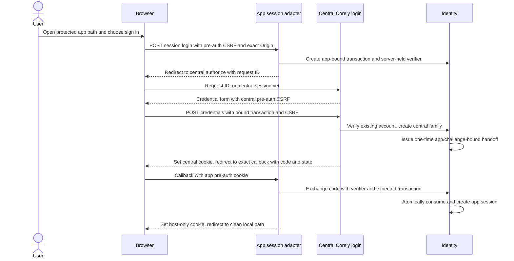
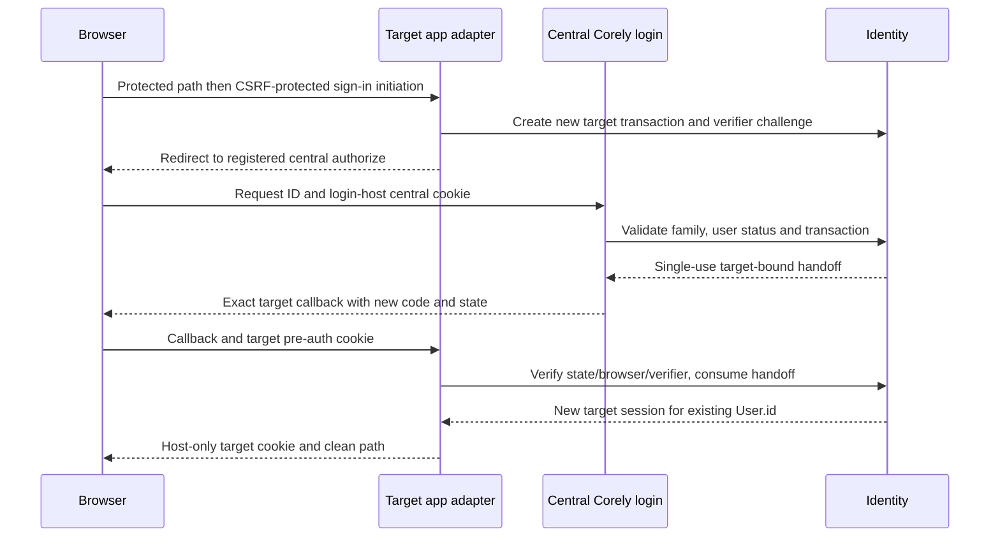
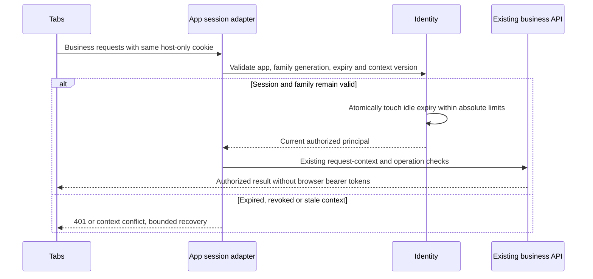
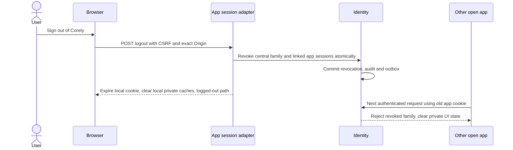
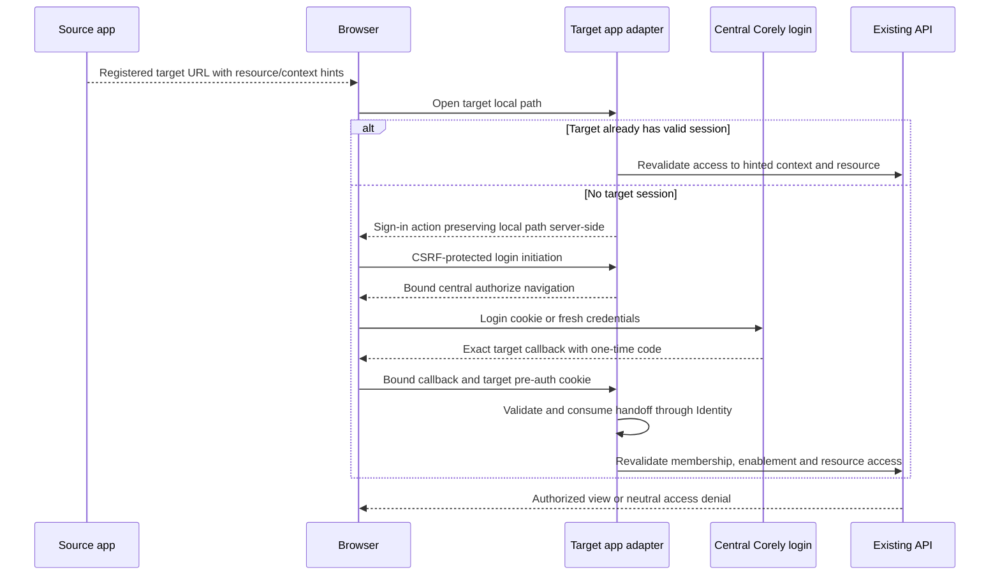

# ADR-0004: Corely-native SSO and per-app browser sessions

Date: 2026-11-08. Status: **Corely-native SSO selected; SURF-01 host plan approved by the requesting maintainer; runtime implementation pending**.
Related: [SURF-02 #382](https://github.com/Corely-AI/corely/issues/382),
[SURF-01 #381 / PR #406](https://github.com/Corely-AI/corely/pull/406),
[surface epic #380](https://github.com/Corely-AI/corely/issues/380).

## Decision and authorization

Use the existing **Corely Identity module as the central authentication owner**.
Add a central login session and narrowly scoped, single-use handoffs that create
independent server-managed sessions on registered first-party app hosts. Keep
one business API and the existing user/membership records. No Keycloak, managed
IdP, external account migration or separately operated identity server is needed.
The existing API deployment and database will need new code, storage, capacity,
HTTPS routing and operational checks; this is not already implemented SSO.

The requesting maintainer initially said “approve and continue” for PR #405 at
`175a61cceaf9cb087afb1752480073ad4865cd52`, then clarified the provider decision:
“use corely auth as SSO, add more code if needed”. This later instruction
supersedes the self-hosted Keycloak choice. It retains central SSO rather than
settling for a separate password login in each app. It authorizes the required
Corely extensions; it does not record a GitHub review or authorize a deployment.

The maintainer separately [approved SURF-01's host plan](https://github.com/Corely-AI/corely/issues/381#issuecomment-6724086565)
on 2026-11-08 and instructed alignment of both ADRs and closure of #381.
Use `app.corely.one`, `invoice.app.corely.one` and `hr.app.corely.one` with
this ADR's exact callback/logout paths. #406 already integrated the architecture
and reuse inventory; [follow-up #407](https://github.com/Corely-AI/corely/pull/407)
records approval in ADR-0003. The earlier alternate names are withdrawn. This
supplies the host decision; provisioning, registrations, protocol tests and
activation remain follow-on work.

This is a deliberate departure from #382's preference for an established OIDC
provider. Corely owns the handoff/session correctness, credential protection,
revocation and recovery burden. The bounded protocol supports only registered
first-party Corely apps: no third-party OAuth clients, delegated scopes, consent
platform, discovery/JWKS server, general token endpoint or new OAuth/OIDC server.
Do not claim standards interoperability. Future federation would require a
separate decision rather than silently extending this protocol.

The existing [#384 central-login ticket](https://github.com/Corely-AI/corely/issues/384),
[#385 session-adapter ticket](https://github.com/Corely-AI/corely/issues/385),
[#386 shared transport ticket](https://github.com/Corely-AI/corely/issues/386) and
[#387 revocation/migration ticket](https://github.com/Corely-AI/corely/issues/387)
own runtime delivery, each on its own branch/PR. #382 owns this prerequisite
design; it does not duplicate those implementations. Their provider-specific
wording is interpreted against the selected Corely-native design before coding.

| Decision or evidence                                                    | State                                                                                                            |
| ----------------------------------------------------------------------- | ---------------------------------------------------------------------------------------------------------------- |
| Existing Identity as SSO owner; no external provider                    | Explicit maintainer instruction, 2026-11-08                                                                      |
| Existing users, membership links, shared API and host-only app sessions | Retained from the approved architecture                                                                          |
| Concrete native handoff and revocation protocol below                   | Revised design implementing that instruction; runtime/security tests not executed                                |
| Host topology                                                           | Explicit maintainer approval recorded under #381 on 2026-11-08; bindings not provisioned                         |
| Runtime code and operations                                             | Follow-on tickets; no deployed session store, capacity test, registration readback or recovery drill established |

## Inspected implementation and reuse

Source baseline: `development` at `3a3492196497d38da088b5222b96cd42bd01ad21`.
Source inspection is not deployed evidence or a runtime security audit.

| Owner / source                                                                                                                                                                                                              | Observed behavior and implication                                                                                                                                                                                                                      |
| --------------------------------------------------------------------------------------------------------------------------------------------------------------------------------------------------------------------------- | ------------------------------------------------------------------------------------------------------------------------------------------------------------------------------------------------------------------------------------------------------ |
| [API composition](../../services/api/src/app.module.ts), [identity HTTP adapter](../../services/api/src/modules/identity/adapters/http/auth.controller.ts)                                                                  | IdentityModule and PortalModule are composed. Identity exposes signup, login, refresh, logout, me, password reset and switch-tenant; these are existing custom auth endpoints, not an OIDC authorization server.                                       |
| [Identity records](../../packages/data/prisma/schema/10_identity.prisma)                                                                                                                                                    | User has a global ID, unique email, password hash and optional partyId. Membership links user, nullable tenant and role; WorkspaceMembership is separate. RefreshToken stores a hash, expiry and revokedAt. Preserve these identities and links.       |
| [Shared client](../../packages/auth-client/src/auth-client.ts), [web wrapper](../../packages/web-shared/src/lib/auth-client.ts), [storage](../../packages/web-shared/src/lib/storage-adapter.ts)                            | Browser tokens persist in localStorage. Client refreshes near expiry, discovers workspaces separately and sends bearer requests. No cross-origin SSO is established by this code.                                                                      |
| [Auth provider](../../packages/web-shared/src/lib/auth-provider.tsx)                                                                                                                                                        | Logout clears local data and query cache; tenant switch clears query cache and resolves current user/workspace again. Preserve equivalent cache isolation in migrated clients.                                                                         |
| [Refresh](../../services/api/src/modules/identity/application/use-cases/refresh-token.usecase.ts), [repository](../../services/api/src/modules/identity/infrastructure/adapters/prisma-refresh-token-repository.adapter.ts) | Refresh looks up a hash, checks revocation/expiry and membership, then separately revokes and creates. This is not evidence of atomic single-use rotation or family replay detection. Do not treat it as an atomic browser-session rotation primitive. |
| [Sign-out](../../services/api/src/modules/identity/application/use-cases/sign-out.usecase.ts)                                                                                                                               | Both token-present and token-absent branches revoke all user refresh tokens in that tenant; existing access JWTs are not individually revoked there. New local logout must not call this assuming per-app behavior.                                    |
| [Tenant switch](../../services/api/src/modules/identity/application/use-cases/switch-tenant.usecase.ts)                                                                                                                     | Checks target membership and issues another token pair. Does not revoke the old pair. The new session adapter must own atomic context changes and stale-request protection.                                                                            |
| [JWT service](../../services/api/src/modules/identity/infrastructure/security/jwt.token-service.ts)                                                                                                                         | Locally signs/verifies JWTs; defaults are 15-minute access and 30-day refresh, configurable. This adapter does not configure OIDC issuer/audience validation. Keep legacy JWT validation separate from new opaque browser sessions.                    |
| [Guard](../../services/api/src/modules/identity/adapters/http/auth.guard.ts), [context authorization](../../services/api/src/modules/identity/application/use-cases/authorize-request-context.usecase.ts)                   | Bearer validation delegates to current membership/workspace checks; that alone grants no resource permission. Retain owning operation permissions, enablement and entitlement checks.                                                                  |
| [POS store](../../apps/pos/src/stores/authStore.ts), [adapter](../../apps/pos/src/lib/storage-adapter.ts), [secure-store helper](../../apps/pos/src/lib/secure-store.ts)                                                    | POS uses AuthClient; native storage uses Expo SecureStore, web fallback uses prefixed localStorage. Preserve existing POS endpoints/storage behavior in this slice.                                                                                    |
| [Portal auth](../../services/api/src/modules/portal/http/portal-auth.controller.ts)                                                                                                                                         | Separate workspace-resolved OTP flow with an HttpOnly refresh cookie and access-token responses. Preserve it; customer portal identities must not automatically become employee accounts.                                                              |

Use Identity application ports for mapping and authenticated context; use
Workspaces public authorization for workspace selection. Keep wire contracts
in packages/contracts. New SSO records belong to Identity and must follow the
[persistence policy](../architecture/DATABASE_PERSISTENCE_STRATEGY.md).
No tables, packages or runtime adapters are introduced by this ADR.

## Exact host and endpoint contract

Use the parent epic's requested origins, matching SURF-01 PR #406. The earlier
`apps.corely.one`, `invoice.corely.one` and `hr.corely.one` alternatives are
withdrawn. The following is the required first-party registration configuration,
not evidence of an already configured issuer or live DNS/ingress change.

| App key               | Browser origin                 | Login initiation (POST)                          | Exact callback (GET)                         | Exact logged-out destination                   |
| --------------------- | ------------------------------ | ------------------------------------------------ | -------------------------------------------- | ---------------------------------------------- |
| app-center            | https://app.corely.one         | https://app.corely.one/api/session/login         | https://app.corely.one/auth/callback         | https://app.corely.one/auth/logged-out         |
| invoice               | https://invoice.app.corely.one | https://invoice.app.corely.one/api/session/login | https://invoice.app.corely.one/auth/callback | https://invoice.app.corely.one/auth/logged-out |
| hr, later reuse proof | https://hr.app.corely.one      | https://hr.app.corely.one/api/session/login      | https://hr.app.corely.one/auth/callback      | https://hr.app.corely.one/auth/logged-out      |

Central login origin is exactly `https://login.corely.one`. A thin `apps/login`
is justified because Corely owns the credential UI; reuse shared UI/auth form
primitives and existing Identity credential/recovery use cases. It has no
business navigation, token storage or duplicate identity model. Its server
routes are `GET /sso/authorize` and CSRF-protected `POST /sso/login` and
`POST /sso/logout`; registration/exchange methods are internal application ports,
not public OAuth endpoints. Exact external paths need deployment routing before activation.

Each app reserves `/api/session/*`, `/auth/callback`, `/auth/logged-out` and an
allowlisted `/api/bff/*` business transport before SPA/legacy catch-alls. Do not
replace all `/auth/*` or `/api/*`: retain legacy login, reset, token APIs and
business routes. Until #381's gated root cutover, `app.corely.one` still serves
the legacy root and deep links. Its App Center is proven on isolated staging
first. The conditional `admin.corely.one` compatibility alias retains ADR-0003's
verification gate; it is not an approved additional SSO client here. Coexisting legacy
code on the App Center origin shares that origin's trust; cookies do not isolate
same-origin scripts. Keep legacy routing explicit and include it in XSS review.

Staging is separately registered with `app.staging.corely.one`,
`invoice.app.staging.corely.one`, `hr.app.staging.corely.one` and
`login.staging.corely.one`, using the same exact paths and isolated API/data.
These bindings are not verified. SURF-18 fixes local ports/origins; SURF-19
provisions hosts and certificates. Neither wildcard previews nor suffix-based
callback matches are allowed. A certificate for `*.corely.one` is not sufficient
evidence for the nested app hosts. Unapproved origins remain disabled.

Registration is server configuration mapping environment + app key to exact
origin/callback/logout URL and enabled state. Browser requests cannot register
clients, choose an issuer or override a callback. Return paths are normalized
local paths stored server-side; reject schemes, scheme-relative paths,
backslashes, control characters, repeated encoding and auth-route loops.
Cross-app links use enumerated app keys and untrusted resource/context hints.
No access token, refresh token, password or session handle appears in a URL.
Only short-lived transaction identifiers, state and one-time handoff codes may
travel through the bound navigation routes; redact them from logs/referrers.

## Runtime placement and owner boundaries

Host the session/SSO application use cases in **services/api's Identity module**.
One reusable HTTP session adapter handles the registered app origins; ingress
routes their reserved paths to that existing API deployment. Static app assets
remain on their own surfaces. This avoids an additional identity service,
business backend, worker or database per app. It still requires reliable existing
API/database hosting and appropriate scale; no availability guarantee follows.

Controllers delegate to Identity application ports. Reuse password verification,
existing account status/recovery and membership repositories; extract common
credential validation where needed instead of calling a token-returning legacy
login endpoint from browser SSO. Keep legacy SignIn behavior compatible while
new SSO rejects disabled users/tenants and adds bounded credential attempt limits.
Do not create a second password store or tenant-specific copy of an auth user.

The BFF entry resolves a typed authenticated principal through Identity's session
authenticator, then applies existing request-context and operation authorization
before delegating to the same business API/use cases. Tenant/workspace intent
is validated with Identity and Workspaces public interfaces. Never trust a
browser-supplied `x-user-id`, tenant, workspace or role as established authority.
Do not create per-app copies of controllers or read other modules' tables.

The browser-session credential is accepted only on registered host-bound session
and BFF routes. Existing bearer routes keep their existing JWT contract; a failed
session check cannot fall back to a header-based bypass. Strip inbound identity
and forwarding assertions before trusted session context is established. If the
adapter later runs in another process, its authenticated transport and assertions
need an explicit contract and negative tests; unauthenticated headers are not a
substitute. No extra process is selected by this decision.

Preserve streaming, uploads/downloads, idempotency keys, request tracing and
cancellations through the allowlisted transport. No arbitrary upstream URL fetch.
Private session/credential/callback/API responses are no-store and excluded from
CDN caching. Build absolute URLs from configured origins; accept forwarding
metadata only from configured ingress peers after stripping client copies.
Unknown Host values, ambiguous cookies and unsupported origins fail closed.

## Session, transaction and handoff records

All new records belong to Identity and its persistence adapters in the existing
identity bucket, following the persistence policy. This design changes no schema.
The implementation must add transactional ports and migrations in its owning ticket.

| Record                   | Required binding and lifecycle                                                                                                                                                                    |
| ------------------------ | ------------------------------------------------------------------------------------------------------------------------------------------------------------------------------------------------- |
| Central session family   | Existing User.id, environment, authentication time, security generation, creation/idle/absolute expiry, revocation. It is the synchronous revocation authority for linked app sessions.           |
| App session              | Hashed random handle, family ID/generation, app key, existing User.id, separately authorized tenant and workspace, context version, CSRF binding, creation/idle/absolute expiry and revokedAt.    |
| App pre-auth transaction | Hashed browser pre-auth handle, environment/app/callback, random state, server-held verifier + S256 challenge, local return path, optional untrusted context hints, expiry and single-use status. |
| One-time handoff         | Hash of random code, immutable transaction/app/callback/environment/challenge, central family/generation and user, expiry and consumedAt. No legacy access/refresh pair.                          |

Use a cryptographic generator with at least 256 bits of entropy for handles,
state, codes and verifiers. Encode verifiers as base64url without padding;
S256 is base64url(SHA-256(ASCII(verifier))), without padding, with no plain-method
fallback. Store handle/code hashes for lookups; encrypt the short-lived
server-held verifier if persisted. Use constant-time comparisons where applicable.
App transaction TTL: five minutes. Handoff code TTL: 60 seconds. Atomically
consume handoff + transaction and create the app session in one unit of work,
locking/checking the central family generation so concurrent logout wins.
An already used/expired/invalid code cannot produce a session or reveal an account.

The central cookie is `__Host-corely-login`; app session cookie is
`__Host-corely-session`. Pre-auth cookies are separate, short-lived and host-only.
All use Secure, HttpOnly, Path=/, SameSite=Lax and **no Domain attribute**.
There is no `.corely.one` bearer cookie, localStorage token bridge, iframe token
copying or postMessage transfer. A sibling cannot set another host's \_\_Host-
cookie in supported browsers, but it can still attempt same-site CSRF.

Use a session-bound synchronizer CSRF token plus exact Origin validation for
every cookie-authenticated mutation, including credential submission, login
initiation, logout and context changes. Reject absent/unapproved origins. CORS
is disabled unless a specific necessary origin is registered; no wildcard with
credentials. Bound authorize/callback navigations are explicit protocol exceptions
to ordinary side-effect-free GET rules, never business mutations. The central
credential form binds its own pre-auth session and CSRF token to the outstanding
app transaction; app state is not sufficient protection for credential submission.

Initial limits are 30-minute idle and 12-hour absolute lifetime. An app session
cannot outlive its central family. Authorized app requests may touch family idle
activity, never extend absolute expiry. Rotate the app handle and CSRF binding
on authentication, account/context changes and privilege elevation. Support
multiple outstanding transactions across tabs rather than a single shared state
slot. Versioned, atomic updates prevent a late rotation from resurrecting logout.

## Five session sequences

These diagrams specify the selected native design; they are not recorded test
runs. Identity and the app session adapter share the existing API runtime.

### Fresh login

The central credentials page is reusable presentation; all authentication rules
stay in Identity. No password or legacy token pair is passed to the target app.

### Existing SSO login

A valid central session avoids another password prompt. Expiry, account recovery
or sensitive-action policy may require fresh credentials. Source-app tokens and
cookies are never sent to the target. Sign-in with a different account requires
an explicit account-change flow and old-cache cleanup.

### Refresh, idle renewal and concurrent tabs

There is no new browser refresh token: opaque sessions renew idle activity
server-side. Do not invoke legacy `/auth/refresh` for this transport. Concurrent
context changes use compare-and-swap versions; old requests fail with 409 and
reload context instead of silently operating in a newly selected workspace.
Never replay an unsafe mutation without its owning idempotency rule.

### Sign out of Corely and optional local logout

Default **Sign out of Corely** revokes the central family and every linked app
session, satisfying #387. An explicitly named **Sign out of this app** may revoke
only that app session if product actually needs it; do not show it as global logout.
No browser traversal/iframe is required for revocation. The login-host cookie may
remain in another origin's jar, but its family is invalid, so it cannot recreate
SSO. Clear it when next visiting login. Other cookies likewise become unusable.

Every request checks the authoritative family generation without a stale positive
cache. Established streams must recheck/disconnect within five seconds of
revocation; background deliveries reauthorize before sensitive effects. Requests
already committed before revocation cannot be undone. Audit and outbox are in
the revocation transaction; consumers are idempotent. Legacy POS/portal JWTs are
not automatically included: explain the remaining old-client behavior explicitly.

### Cross-app deep link

A link cannot switch an existing app session's tenant via GET. Offer explicit
context selection; recheck tenant membership and workspace access independently,
rotate context/handle atomically and clear the former context's caches/offline
state. Tabs on one app host share that app context; other app hosts do not change
implicitly. Resource hints never grant access or reveal unauthorized existence.

## Identity continuity, compatibility and rollback

- New central and app sessions reference the **existing User.id directly**.
  Existing tenant memberships, WorkspaceMembership, roles, partyId and People
  identity links stay intact. There is no external subject or email-based account
  merge, no password hash export and no account migration to another provider.
  Never confuse employee, party, workspace, tenant and auth-user identities.
- Reuse Corely invitation and recovery rules. Password reset/account disable
  increments the new-session security generation and revokes affected families
  transactionally. Test the old-client revocation policy separately; do not imply
  legacy access JWTs are instantly invalidated by the existing logout implementation.
- Keep `/auth/*`, JWT signing configuration, refresh contracts, POS storage,
  portal OTP, public booking and checkout compatible. No new session cookie is
  accepted as a legacy bearer or on an unregistered host. Inventory deployed
  non-browser clients before later deprecation; this source trace is not complete
  deployment inventory. Authentication remains useful if AI is unavailable.
- Deliver #384/#385/#386/#387 additively with per-surface flags and an isolated
  multi-origin environment. Rehearse fresh/existing users, reset/invitations,
  logout, expiry, membership removal and parallel old/new clients. Legacy
  localStorage credentials are cleared only on the affected migrated origin
  after successful new login; never carry them to a different origin. Quarantine
  offline writes by original user/context; offer authorized recovery/export rather
  than replaying them under another account or silently discarding them.
- App Center + Invoice pilot uses #381's approved host/legacy-routing plan;
  HR follows as the reuse proof. Record actual TLS/ingress, exact registered origins,
  credential limits, session cleanup, metrics, operator, backup/restore and rollout
  thresholds before production. Do not claim a live registration from this matrix.
- Roll back by disabling new initiation/session routes through the reviewed route
  flags and restoring legacy entry mappings. Require legacy reauthentication;
  revoke new families, preserve users/memberships and retain additive records
  for diagnosis. Do not restore revoked sessions from backups or convert opaque
  cookies to browser JWTs. No database down migration or domain-data rollback.

## Abuse cases and required tests

These are implementation requirements, not passing security tests or confirmed
vulnerabilities. Test with synthetic accounts and disposable sessions.

| Lower-trust action or failure                                                 | Expected result                                                                                                                            |
| ----------------------------------------------------------------------------- | ------------------------------------------------------------------------------------------------------------------------------------------ |
| Attacker submits central credentials or app login from sibling origin         | Exact Origin plus bound CSRF rejects, despite SameSite cookies being sent.                                                                 |
| Attacker changes client key, callback, origin or return URL                   | Only server-registered immutable values used; external/encoded destinations rejected.                                                      |
| Code stolen, replayed, expired or exchanged for another app/environment       | No session; browser binding, verifier/challenge and exact transaction/client/environment must all match.                                   |
| Wrong state/pre-auth browser, two callback requests or logout racing exchange | Atomic single-use exchange and family-generation check create at most one still-authorized session.                                        |
| Login request initiated in attacker browser is opened by victim               | Victim cannot finish callback into attacker transaction without its app pre-auth binding; no account/session confusion.                    |
| Forged user/tenant/workspace/role or forwarded-host headers                   | Trusted registry and server session determine authority; current API authorization still applies.                                          |
| Concurrent tabs switch tenant while stale mutation is pending                 | Context version rejects stale action; private caches cleared; no replay in another workspace.                                              |
| Login with disabled user or removed membership; stale deep link               | Current user and resource checks deny; no existence disclosure or permission from menu visibility.                                         |
| Global logout with HR tab open, including central cookie left in jar          | Next HR request denied; central family cannot mint another handoff; streams disconnected within bound.                                     |
| Old refresh or delayed callback arrives after logout                          | Cannot recreate a new session from the revoked family or stale transaction.                                                                |
| Sibling attempts parent-domain cookie injection                               | Host-prefixed cookie semantics and duplicate-cookie rejection preserve host binding; CSRF remains independently enforced.                  |
| Same-origin XSS, including legacy app coexistence                             | HttpOnly limits handle reads, but same-origin actions remain possible; CSP/output encoding and sensitive-action policy still required.     |
| API/database unavailable or uncertain exchange commit                         | Fail closed; callback does not mint a second session on blind retry; restart sign-in with an explicit recoverable message.                 |
| Password reset/account switch, cached pages or offline writes                 | New-session generation revocation; old private state not rendered to new account; queued commands remain bound to original context.        |
| Credential guessing or transaction/code issuance flood                        | Identity applies bounded per-account and trusted-source limits, generic errors, expiry and cleanup; capacity tested offline before launch. |

Coverage: shared browser auth, Identity refresh/logout/context, POS storage and
portal auth boundary source trace. Not audited: every operation permission,
production proxies, live sessions or infrastructure. No live exploit,
authentication attempt, deployment or availability test was performed.

## Operational limits and recovery

Corely-native SSO has no provider quota/SLA or external issuer recovery dependency.
Its availability follows the existing API, database and host routing. Assign an
operator and record measurable RTO/RPO, capacity, credential-throttle thresholds,
cleanup schedules, clock-skew tolerance and recovery procedures before activation.
Use existing background execution for expired-record cleanup; never create a worker.

Keep login and session secrets out of telemetry, URLs, localStorage and caches.
Instrument bounded failures without account enumeration. Encrypt backups and any
persisted verifier; access to session storage is privileged. Restore must not
resurrect revoked sessions: use a post-restore generation reset/invalidation and
force new login. Session/database outage denies authenticated traffic rather
than trusting stale caches. Public unauthenticated booking remains independent.
There is no indefinite stale-session grace or fallback to passwordless legacy
headers. Display retry/restart guidance with no redirect loop.

## References and delivery evidence

- [Parent epic #380](https://github.com/Corely-AI/corely/issues/380) and [SURF-01 PR #406](https://github.com/Corely-AI/corely/pull/406): requested hosts and legacy compatibility direction; subsequent maintainer approval is recorded above, with no live activation inferred.
- [OAuth Security BCP, RFC 9700](https://www.rfc-editor.org/rfc/rfc9700.html) and [PKCE, RFC 7636](https://www.rfc-editor.org/rfc/rfc7636.html): security references for redirect/replay and challenge binding; this design is not an OAuth/OIDC implementation.
- [Connected apps](../architecture/connected-apps.md), [operational access](../platform/operational-access.md): existing owners and independent authorization.

The requesting maintainer selected Corely-native SSO. #382 records the design;
#384–387 own code delivery and fresh runtime evidence. No SSO readiness,
registration, specialist approval, merge or release is claimed by this ADR.
