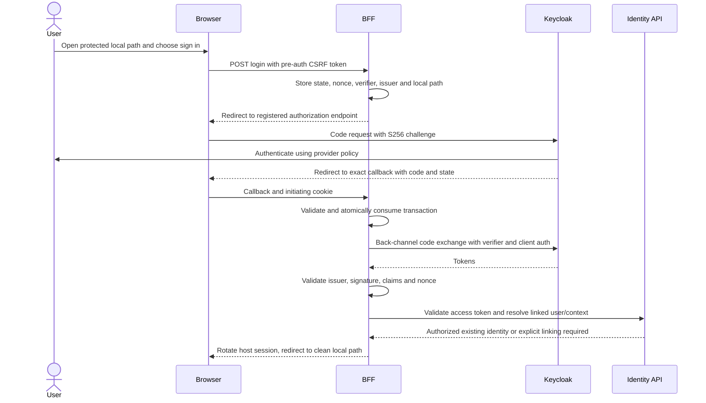
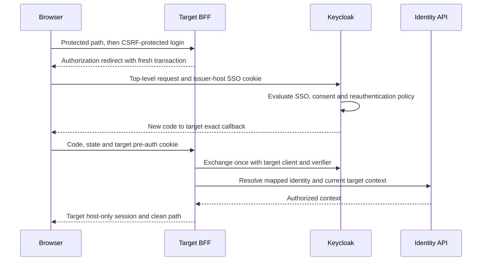
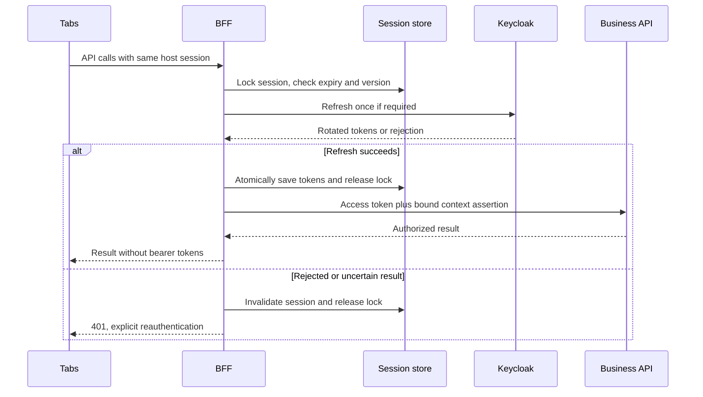
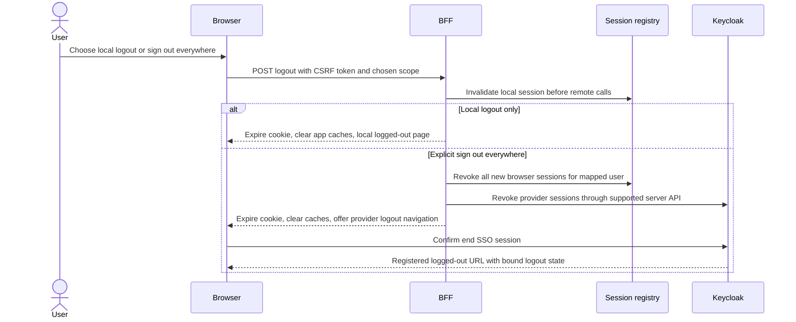
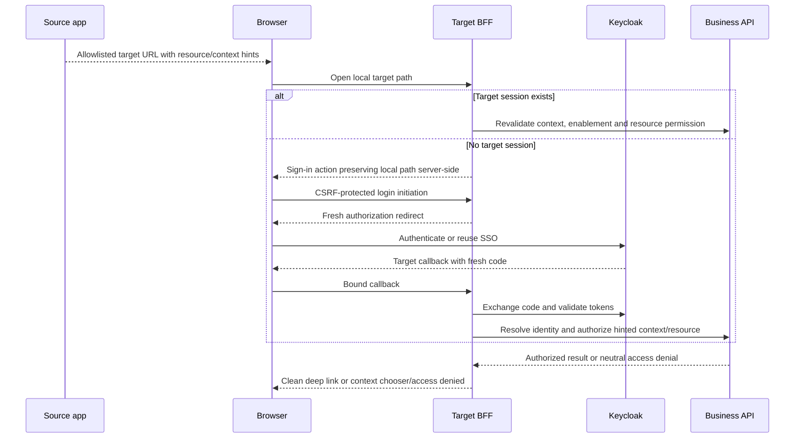

# ADR-0004: Central identity and per-app browser sessions

Date: 2026-11-08. Status: **Proposed; not approved or deployed**.
Related: [SURF-02 #382](https://github.com/Corely-AI/corely/issues/382),
[SURF-01 #381](https://github.com/Corely-AI/corely/issues/381),
[surface epic #380](https://github.com/Corely-AI/corely/issues/380).
ADR-0003 is reserved for the prerequisite focused-surface decision.

## Decision and approval boundary

Propose **self-hosted Keycloak**, using its established OpenID Connect (OIDC)
authorization code flow with S256 PKCE, and a reusable backend-for-frontend
(BFF) session adapter mounted at each approved browser origin. Each surface
gets its own confidential OIDC client, credentials and host-only session.
SSO happens through top-level navigation to the issuer, never by sharing
bearer tokens or cookies between app origins. All surfaces use the existing
modular business API; there is no Invoice or HR business backend.

Choose self-hosting to retain control over issuer continuity, subject mapping,
exports and recovery without making a managed vendor a prerequisite for OSS
deployments. This introduces a real operations dependency. The platform operator
must own patching, supported release selection, database backup/restore, key
rotation, monitoring and incident response. No operator, budget, capacity test,
SLO or support contract has been verified. If that responsibility cannot be
accepted, reopen this decision for a managed OIDC service before implementation;
do not silently substitute a provider or build an OAuth server in Corely.

Managed OIDC would transfer some operational work but needs separate decisions
on account migration, custom domains, export, region, quotas, support and cost.
Direct SPA tokens retain browser credential exposure; parent-domain cookies
expand sibling-host authority. Both are rejected for new focused surfaces.

The hard prerequisite #381 was open at inspection. Its host/callback matrix and
legacy traffic decision must be approved before these proposed registrations
become binding. This document supplies a reviewable design, not approval evidence.
Platform, security and product owners must record their decisions on the PR:

| Gate     | Evidence required                                                     | Current state |
| -------- | --------------------------------------------------------------------- | ------------- |
| SURF-01  | Approved hosts, legacy traffic and surface ownership                  | Pending       |
| Platform | Provider operation, support owner and recovery objectives accepted    | Pending       |
| Security | Five sequences, abuse cases, identity linking and revocation accepted | Pending       |
| Product  | Account recovery, logout wording and migration experience accepted    | Pending       |

## Inspected implementation and reuse

Source baseline: `development` at `3a3492196497d38da088b5222b96cd42bd01ad21`.
Source inspection is not deployed evidence or a runtime security audit.

| Owner / source                                                                                                                                                                                                              | Observed behavior and implication                                                                                                                                                                                                                |
| --------------------------------------------------------------------------------------------------------------------------------------------------------------------------------------------------------------------------- | ------------------------------------------------------------------------------------------------------------------------------------------------------------------------------------------------------------------------------------------------ |
| [API composition](../../services/api/src/app.module.ts), [identity HTTP adapter](../../services/api/src/modules/identity/adapters/http/auth.controller.ts)                                                                  | IdentityModule and PortalModule are composed. Identity exposes signup, login, refresh, logout, me, password reset and switch-tenant; these are existing custom auth endpoints, not an OIDC authorization server.                                 |
| [Identity records](../../packages/data/prisma/schema/10_identity.prisma)                                                                                                                                                    | User has a global ID, unique email, password hash and optional partyId. Membership links user, nullable tenant and role; WorkspaceMembership is separate. RefreshToken stores a hash, expiry and revokedAt. Preserve these identities and links. |
| [Shared client](../../packages/auth-client/src/auth-client.ts), [web wrapper](../../packages/web-shared/src/lib/auth-client.ts), [storage](../../packages/web-shared/src/lib/storage-adapter.ts)                            | Browser tokens persist in localStorage. Client refreshes near expiry, discovers workspaces separately and sends bearer requests. No cross-origin SSO is established by this code.                                                                |
| [Auth provider](../../packages/web-shared/src/lib/auth-provider.tsx)                                                                                                                                                        | Logout clears local data and query cache; tenant switch clears query cache and resolves current user/workspace again. Preserve equivalent cache isolation in migrated clients.                                                                   |
| [Refresh](../../services/api/src/modules/identity/application/use-cases/refresh-token.usecase.ts), [repository](../../services/api/src/modules/identity/infrastructure/adapters/prisma-refresh-token-repository.adapter.ts) | Refresh looks up a hash, checks revocation/expiry and membership, then separately revokes and creates. This is not evidence of atomic single-use rotation or family replay detection. Do not reuse it as the OIDC refresh protocol.              |
| [Sign-out](../../services/api/src/modules/identity/application/use-cases/sign-out.usecase.ts)                                                                                                                               | Both token-present and token-absent branches revoke all user refresh tokens in that tenant; existing access JWTs are not individually revoked there. New local logout must not call this assuming per-app behavior.                              |
| [Tenant switch](../../services/api/src/modules/identity/application/use-cases/switch-tenant.usecase.ts)                                                                                                                     | Checks target membership and issues another token pair. Does not revoke the old pair. The new session adapter must own atomic context changes and stale-request protection.                                                                      |
| [JWT service](../../services/api/src/modules/identity/infrastructure/security/jwt.token-service.ts)                                                                                                                         | Locally signs/verifies JWTs; defaults are 15-minute access and 30-day refresh, configurable. This adapter does not configure OIDC issuer/audience validation. An IdP token cannot simply replace a legacy JWT.                                   |
| [Guard](../../services/api/src/modules/identity/adapters/http/auth.guard.ts), [context authorization](../../services/api/src/modules/identity/application/use-cases/authorize-request-context.usecase.ts)                   | Bearer validation delegates to current membership/workspace checks; that alone grants no resource permission. Retain owning operation permissions, enablement and entitlement checks.                                                            |
| [POS store](../../apps/pos/src/stores/authStore.ts), [adapter](../../apps/pos/src/lib/storage-adapter.ts), [secure-store helper](../../apps/pos/src/lib/secure-store.ts)                                                    | POS uses AuthClient; native storage uses Expo SecureStore, web fallback uses prefixed localStorage. Preserve existing POS endpoints/storage behavior in this slice.                                                                              |
| [Portal auth](../../services/api/src/modules/portal/http/portal-auth.controller.ts)                                                                                                                                         | Separate workspace-resolved OTP flow with an HttpOnly refresh cookie and access-token responses. Preserve it; customer portal identities must not automatically become employee accounts.                                                        |

Use Identity application ports for mapping and authenticated context; use
Workspaces public authorization for workspace selection. Keep wire contracts
in packages/contracts. Future external-subject mappings belong to Identity,
and session persistence needs an explicit adapter/storage decision under the
[persistence policy](../architecture/DATABASE_PERSISTENCE_STRATEGY.md).
No tables, packages or runtime adapters are introduced by this ADR.

## Registration and origin contract

The following is an **exact proposed production registration set**, conditional
on #381. None was checked against DNS, ingress or an IdP console. For the proposed
Keycloak realm `corely`, issuer is
`https://login.corely.one/realms/corely`; the bare login host is not the issuer.
Discovery and endpoint URLs must be pinned to that configured issuer.

| Surface / client                  | Login initiation                      | Exact callback                           | Exact post-logout URL                      |
| --------------------------------- | ------------------------------------- | ---------------------------------------- | ------------------------------------------ |
| App Center / corely-app-center    | https://apps.corely.one/auth/login    | https://apps.corely.one/auth/callback    | https://apps.corely.one/auth/logged-out    |
| Invoice / corely-invoice          | https://invoice.corely.one/auth/login | https://invoice.corely.one/auth/callback | https://invoice.corely.one/auth/logged-out |
| HR / corely-hr, later reuse proof | https://hr.corely.one/auth/login      | https://hr.corely.one/auth/callback      | https://hr.corely.one/auth/logged-out      |
| Legacy app.corely.one             | Existing login remains                | No new OIDC registration in this slice   | Existing logout remains                    |

`apps.corely.one` is a proposed App Center name, not an established deployment.
HR maps to the existing People owner, not a new identity store. A host change
requires revising this table and #381 together before registration. Staging and
local development use separate realms/clients and an enumerated exact URL list
in their deployment configuration; no wildcard previews, localhost callbacks in
production, wildcard redirects or dynamically supplied issuers are permitted.
Third-party login initiation, if enabled, must also use only the listed login URL.

Login initiation is a same-origin POST with CSRF protection. An unauthenticated
GET to a protected deep link displays a same-origin sign-in action with a short-lived
pre-auth session and CSRF token. Callback is a top-level GET using response_mode=query;
only a short-lived, single-use code and state may appear there. Callback responses
have no third-party resources, use no-store and Referrer-Policy: no-referrer,
and immediately redirect to a clean local URL. Redact codes/state from logs.
Access tokens, refresh tokens and session IDs never appear in URLs or browser JS.
Use provider logout with client_id, a registered post_logout_redirect_uri and
bound logout state; accept provider confirmation rather than sending an ID token
in the navigation URL.

Return destinations are server-stored transaction data, referenced by opaque
state. Accept only normalized local application paths, rejecting scheme-relative
URLs, schemes, backslashes, control characters, double-encoded escapes and auth
route loops. Cross-app navigation resolves an enumerated app key to the above
origin; no arbitrary `returnTo`, hostname suffix matching or redirect chains.
Tenant/workspace/resource identifiers in a link remain untrusted hints.

## Session and API adapter contract

- Browser cookie: `__Host-corely-session`, Secure, HttpOnly, Path=/,
  SameSite=Lax, **no Domain attribute**. Store only a cryptographically random
  opaque session handle; hash the lookup handle in server storage. The issuer
  owns its separate login-host cookie. No `.corely.one` bearer cookie, iframe
  token copying, localStorage token bridge or postMessage token relay.
- Server session binds environment, surface/client, issuer/subject, Corely user,
  selected tenant and workspace separately, context version, provider session ID,
  expiry and encrypted server-side tokens. Rotate handle on authentication,
  account/context changes and privilege elevation. Initial proposed limits:
  30-minute idle and 12-hour absolute lifetime, no silent extension of absolute
  expiry. Confirm with security/product; provider expiry can shorten them.
- Pre-auth transaction binds random state, nonce, S256 verifier, client/issuer,
  callback, local return path and initiating browser cookie. TTL five minutes;
  atomically consume once, including failures. Support multiple outstanding
  transactions rather than one shared state slot for concurrent tabs.
- Use a maintained OIDC relying-party library, not hand-written protocol code.
  Validate signature with pinned issuer JWKS/algorithm policy, exact iss,
  aud/client and azp where required, exp/nbf, nonce and code/redirect/PKCE binding.
  Reject token-supplied key URLs. ID tokens authenticate the RP and never serve
  as API bearer tokens. Bound JWKS retrieval, cache lifetime and unknown-kid retry.
- Every cookie-authenticated mutation, including login, logout and context
  selection, requires a session-bound synchronizer token in a custom header or
  same-origin form plus an exact Origin check. Reject missing/unapproved origins;
  never allow credentialed wildcard CORS. Same-site sibling hosts still fail
  Origin/CSRF checks. GET/HEAD must be side-effect free except the bound callback.
- Only configured ingress peers may supply trusted forwarding metadata. Ingress
  strips client Forwarded/X-Forwarded-\* headers; configure exact proxy trust,
  canonical host/scheme and TLS. Build redirects from configuration, never Host
  or forwarded headers. Reject unknown hosts and ambiguous session cookies.
- Each host serves `/auth/*`, `/session` and an allowlisted `/api/*` proxy through
  the shared adapter. Vite assets alone cannot host this: route these paths to a
  server runtime, with private responses excluded from CDN caching. Authenticate
  SSE/download/upload routes too; preserve idempotency keys and cancellations.
  Do not make an arbitrary upstream URL proxy. Strip browser Authorization,
  Cookie and authority headers; rebuild approved context from the server session.
- Add a distinct Identity OIDC adapter to the same API. API accepts a provider
  **access token** only for the pinned issuer and dedicated `corely-api` audience,
  allowlisted algorithms/clients and required scopes; it maps issuer/subject to
  the existing user and then checks user status, current memberships, tenant state, workspace
  access and owning operation permissions. Require the same validation as at
  the RP where applicable. Keycloak must issue this audience via reviewed client
  configuration; an ID token or token for another API is rejected.
- The API needs an authenticated session/context binding, not just untrusted
  tenant headers: session registry binds provider sid, surface and context version.
  BFF forwards a short-lived authenticated assertion bound to token digest,
  session, tenant/workspace and version over authenticated internal transport.
  API validates assertion and current registry version before authorization;
  browser input cannot create one. Specify its wire schema, keys and internal
  audience in the implementation ticket. BFF holds no legacy JWT signing key.
  Legacy bearer verification remains a separate, explicitly selected validation
  path; no retrying arbitrary OIDC tokens against the legacy verifier on failure.
- Serialize refresh with a distributed session lock and compare-and-swap version.
  Persist rotated tokens atomically before release. An uncertain refresh result
  forces reauthentication; do not replay an old rotating refresh token blindly.
  No automatic replay of a business mutation without its owning idempotency rule.
- Tenant/workspace selection is an authorized server mutation. Revalidate both,
  rotate context/version atomically and clear browser caches/offline data for the
  former context. Tabs on that host share context; reject stale mutations with
  409 and reload context. Other hosts retain independent context and authorize
  any deep-link hint anew. Never infer tenant authority from provider groups.

## Proposed sequences for approval

These diagrams are design artifacts, not recorded passing tests. `Identity API`
is the existing business API with the proposed OIDC adapter; `BFF` is the adapter
at the requested surface. Neither is a new business domain.

### Fresh login

Unknown or ambiguous mappings stop before app access; they never auto-link by email.

### Existing SSO login

SSO does not promise silent login: provider policy may require interaction. No source
app cookie or token is sent to the target app.

### Refresh and concurrent tabs

### Local logout and sign out everywhere

Local logout leaves SSO and other app sessions active; label that honestly.
Per-client token revocation is best effort after local invalidation. Sign out
everywhere invalidates the Corely session registry synchronously and queues
idempotent provider revocation retries through the existing background runtime
and transactional outbox. It must not depend on a successful redirect or browser
visiting every app. Validate signed provider back-channel logout messages
(issuer, audience, event, sid/sub, freshness and jti replay) to invalidate matching
sessions on provider-initiated logout. Legacy POS/portal sessions remain outside
this new-browser scope; do not label it all-device logout until separately migrated.
Do not use legacy tenant-wide logout for local app logout.

### Cross-app deep link

Context changes require explicit user selection, not a GET link switching an
existing session. Do not disclose resource existence to unauthorized callers.

## Identity continuity, compatibility and migration

1. Add an Identity-owned mapping unique on `(issuer, subject)` to existing
   `User.id`; multiple explicitly verified provider subjects may map to one user.
   Require stable subject configuration across clients, or separately link pairwise
   subjects with proof. Never use email, employee ID, partyId, tenantId or
   workspaceId as the external identity key. Keep memberships/roles and People
   links authoritative in Corely. Never grant host context from an IdP claim.
2. Rehearse an export/restore and deterministic mapping import using synthetic
   accounts. Prefer a bounded, audited administrative mapping from authoritative
   account records with duplicate/conflict review. Otherwise require fresh proof
   of both the existing account and the OIDC account in a dedicated linking flow.
   Matching or verified email alone is insufficient. Lost-credential cases go
   through approved recovery; no new employee/account is auto-created by email.
   Credential/hash import compatibility is unverified; use provider enrollment
   or reset after linking if import cannot be supported. Do not copy password
   hashes into a browser or make Keycloak depend on an unrestricted legacy login proxy.
3. Implement additive, separately configured validation and the shared BFF on a
   disposable environment first. Keep legacy `/auth/*` contracts, signing keys,
   token storage and refresh behavior for old clients. Customer portal OTP,
   POS, public booking and checkout remain on their existing paths. Inventory
   non-browser consumers before any later deprecation; this source trace is not
   a complete deployment/client inventory.
4. Pilot App Center + Invoice only after #381 and this design are approved;
   HR follows as a reuse proof. Use per-surface routing flags. Clear old tokens
   only on the migrated origin after successful session establishment. Never
   transport old localStorage tokens to the new host. Link failure keeps the
   existing account intact and gives a recovery path without duplicate signup.
5. Test parallel legacy/new clients, membership removal, context changes, mapping
   conflicts, refresh races and provider outage. Define canary thresholds and
   an operator-owned rollback rehearsal before production. Preserve audit/outbox
   transactionality for mapping, session revocation and sensitive context changes.
6. Roll back by disabling new login initiation/proxy routing and returning affected
   users to the approved legacy entry URL; require legacy reauthentication.
   Revoke new server/provider sessions, retain mappings and additive storage for
   diagnosis, preserve legacy keys/contracts and never restore revoked sessions
   from backup. No database down migration or export of BFF tokens to browsers.
   Provider account disable/password changes during dual operation need an explicit
   Corely disable/revocation process; they do not automatically disable legacy login.

## Abuse cases and expected verification

All outcomes below are requirements for future synthetic integration/browser
tests and security review, **not passing results or confirmed vulnerabilities**.

| Lower-trust action / failure                                                    | Required outcome                                                                                                                      |
| ------------------------------------------------------------------------------- | ------------------------------------------------------------------------------------------------------------------------------------- |
| Compromised sibling sets Domain cookie or submits mutation with ambient cookies | Host-prefixed cookie cannot be replaced by Domain cookie; exact Origin plus session CSRF rejects request even though same-site.       |
| Attacker supplies external, encoded, scheme-relative or auth-loop return path   | Reject before starting login; no redirect outside explicit target origin/path policy.                                                 |
| Stolen/replayed code, wrong state/nonce/verifier/client or concurrent callback  | No session; transaction consumed at most once; no token/code logging.                                                                 |
| Valid token for wrong issuer, audience, token type or attacker-selected JWKS    | API/RP rejects; no fallback to legacy verifier.                                                                                       |
| Two tabs or two BFF replicas refresh one session                                | One rotation under lock/CAS; waiters reload new version; uncertain exchange requires login.                                           |
| Mutation queued before tenant switch arrives after switch                       | API registry/version check rejects stale context; cached old data cleared; no implicit replay in new tenant.                          |
| URL requests tenant/workspace without membership or disabled app                | Current API authorization denies independently of SSO/menu; neutral resource response.                                                |
| Attacker has same email at another issuer or changes email                      | No auto-link or membership grant; explicit identity proof/recovery required.                                                          |
| Client spoofs Host/X-Forwarded-Host/proto                                       | Unknown host rejected; configured callbacks unaffected; only known proxy metadata trusted.                                            |
| Logout races refresh or provider revocation is unavailable                      | Local tombstone/version wins; late refresh cannot resurrect session; retries cannot recreate it.                                      |
| Provider sends forged/replayed back-channel logout                              | Reject signature/claim/event/replay mismatch; valid event invalidates only bound sessions.                                            |
| IdP unavailable, signing key unknown or session store unavailable               | New login/refresh fails closed with retry guidance; no password fallback or stale-key trust expansion.                                |
| Same-origin XSS issues an authorized request                                    | HttpOnly prevents token reads but cannot stop same-origin actions; retain CSP, output encoding and sensitive-action confirmation.     |
| Legacy POS logs out during pilot                                                | Existing tenant-wide refresh revocation semantics remain; new local browser logout does not invoke it. Test compatibility explicitly. |

Coverage: source review of shared browser auth, Identity refresh/logout/context,
POS storage and portal auth boundary. Not reviewed: every API permission, live
ingress, provider configuration, account imports or production incident behavior.
No live exploit, authentication attempt or availability test was performed.

## Provider limits and recovery contract

Keycloak documents discovery, token, logout and revocation interfaces; protocol
support is not an SLA or evidence of a working Corely deployment. Pin a supported
version and test the exact selected features before integration. Establish:

- Operator-owned capacity/connection/rate limits, refresh rotation/reuse settings,
  SSO idle/max lifetime, MFA/recovery policy, clock skew and key rollover overlap.
  No numerical provider quota, capacity or support guarantee is asserted here.
- Separate realm/client secrets per environment; least-privileged server credential
  for administrative session revocation; documented secret rotation and access audit.
- Encrypted backups of realm configuration, database and required keys with restore
  rehearsal, subject continuity and revocation reconciliation. Assign measurable
  RTO/RPO and incident owner before launch. Self-hosting HA depends on database,
  network/load balancer and compute; adding replicas alone is insufficient.
- During issuer outage, existing sessions may use already valid access tokens only
  until token expiry and session limits, provided API context/registry checks work.
  No grace extension or new session from a cached ID token. Unknown keys fail closed;
  known cached keys are usable only within the documented cache policy. Session
  store outage denies authenticated traffic; public unauthenticated booking remains
  independent. Use bounded timeouts/backoff and an accessible retry/sign-in message.
- If logout reaches Corely but not IdP, deny all invalidated new browser sessions
  immediately and show central sign-out incomplete until provider retries succeed.
  Prevent SSO recreation for the revoked provider sid until confirmed termination
  or fresh provider authentication after the revocation timestamp, requiring
  prompt=login/max_age=0 and validated auth_time on that recovery flow.

## References

- [OAuth Security BCP, RFC 9700](https://www.rfc-editor.org/rfc/rfc9700.html): authorization code, PKCE, redirect and replay requirements.
- [OIDC Core](https://openid.net/specs/openid-connect-core-1_0.html): identity claims and ID-token validation.
- [Keycloak OIDC endpoints](https://www.keycloak.org/securing-apps/oidc-layers): provider interface capabilities; not Corely deployment evidence.
- [Keycloak RP-initiated logout](https://www.keycloak.org/docs/latest/server_admin/index.html#_oidc-logout): registered return URLs and client identification.
- [Keycloak HA responsibilities](https://www.keycloak.org/high-availability/introduction): operator-owned availability and recovery.
- [Connected apps](../architecture/connected-apps.md), [operational access](../platform/operational-access.md): retained ownership and authorization.

Approval requires resolving the gate table, accepting the sequences/abuse cases,
and recording provider/host/migration decisions. No auth implementation begins
on the strength of this proposed ADR alone.
