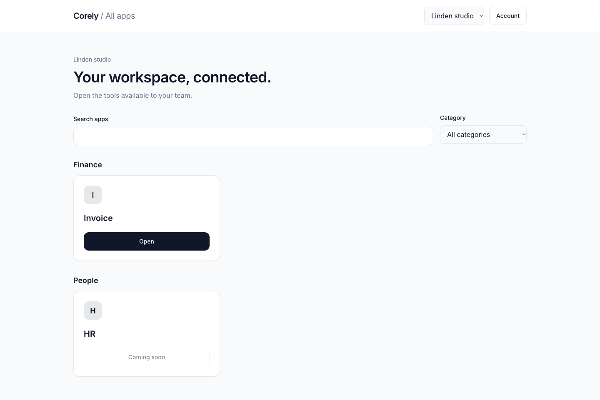
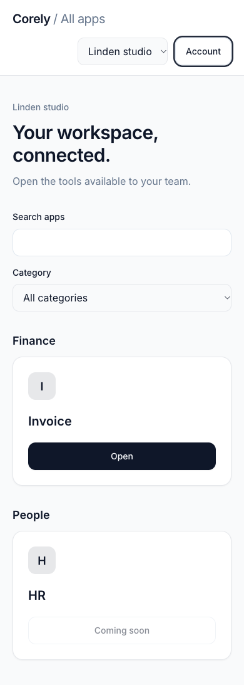
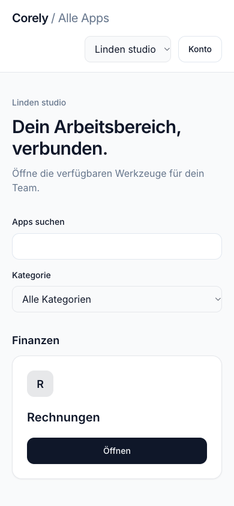
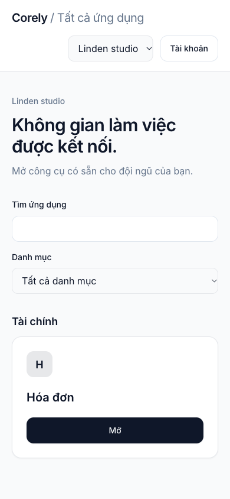
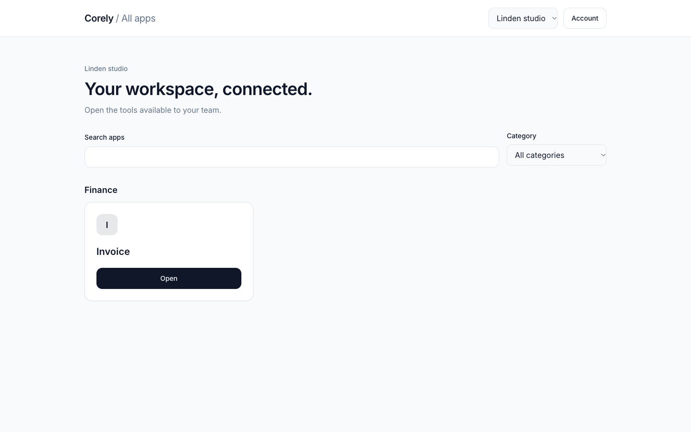
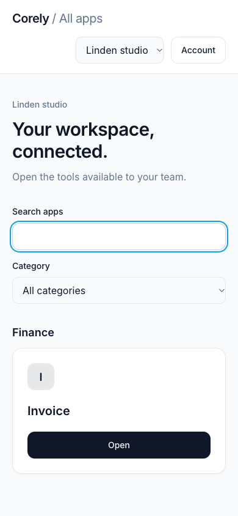
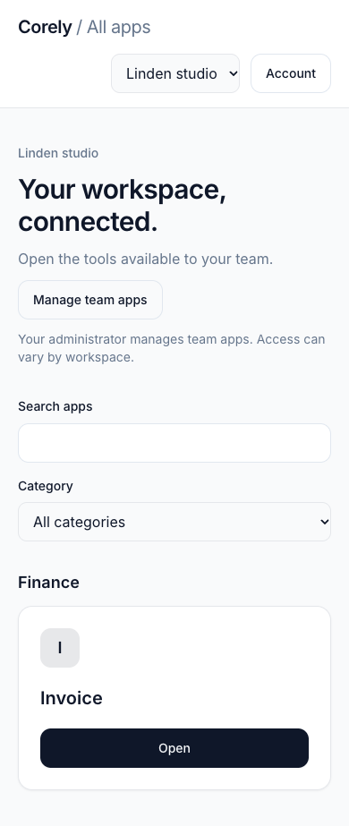
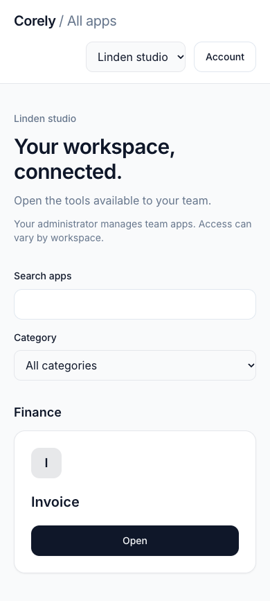
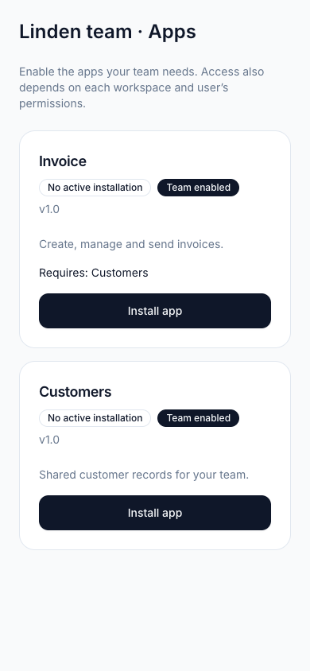
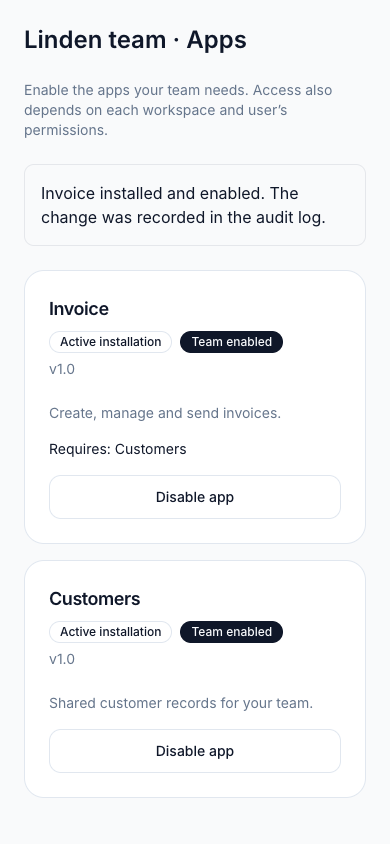

# App Center

`apps/app-center` is the thin Vite/React launcher for the approved App Center
surface. It uses the existing workspace/session boundary and staff launch
projection. It contains no Invoice or People screens, installation logic or
subscription checkout. Existing `apps/portal` routes and hosting are unchanged.

## Run and build

Follow [local focused surfaces](../guides/LOCAL_FOCUSED_SURFACES.md) to configure
trusted HTTPS origins, the API and central sign-in. Then run `pnpm dev:app-center`.
`pnpm build:app-center` builds through the configured focused-surface wrapper;
`pnpm --filter @corely/app-center build` builds the standalone static client.
The bare Vite server/preview supplies static assets only, without authenticated
session/BFF routing. It must not proxy privileged API traffic directly.

Mount the build behind the same-origin session/BFF gateway and a static-history
fallback to `index.html`. Production/staging routing belongs to SURF-19 (#399);
legacy-host migration and traffic cutover remain gated by SURF-15/SURF-24
(#396/#404). This change does not publish or route production traffic.

## Directory behavior

`WorkspaceSessionProviders` resolves authenticated memberships through the existing
workspace owner. Without a workspace hint, users explicitly select a workspace;
invalid or unauthorized hints never silently select another workspace. The chosen
workspace stays in the URL and is rebound on selection and refresh. Query caches
are isolated by user, tenant, workspace and app.

The directory calls `GET /menu/launches` through the session client. Only returned
entries with a supported launch descriptor become tiles. Search matches localized
app names; category browsing uses the descriptor's Finance/People category. No
planned app is manufactured from the long-term catalog. The server controls
visibility; absence of accessible destinations produces an empty state without
restricted metadata. Dependency topology is omitted from staff discovery. App enablement remains a host administrator workflow.

Only enabled, available entries with a valid configured origin can open. Disabled,
unconfigured and Coming soon entries have disabled controls and a neutral reason.
Each open action refreshes the projection; removed grants or availability prevent
navigation. A workspace unmount discards a pending launch. The destination receives
only the encoded workspace hint and independently revalidates access. HR remains
Coming soon until the owning server configuration releases it. Origin/return URL
query parameters are never used to choose a destination.

The directory has its own lightweight header using shared UI controls and account/
workspace session actions. `FocusedAppShell` remains for Invoice/HR business
navigation: its required `AppLaunchId` and business menu routes intentionally do
not include App Center. The launcher reuses its launch URL validation helper.
English, German and Vietnamese copy follows browser language; unknown locales use
English. Manual search and opening apps require no AI.

## UI/UX evidence

Checked November 9, 2026 using Chromium against the production Vite preview,
synthetic authenticated staff sessions and route-mocked API responses. Desktop
1440×900 and phone 390×844: categorized directory, search/no-match, category
filtering, workspace switching, direct refresh, account-menu keyboard focus return,
sign-out, loading, empty, retryable directory error, session outage/retry, disabled
HR and access removed before launch. Invoice and synthetically released HR both
opened their configured origins with the selected workspace hint. EN/DE/VI phone
layouts had no horizontal overflow. This is browser/client evidence, not a live
issuer/API authorization or production routing test.

| Desktop                                                    | Phone                                                   |
| ---------------------------------------------------------- | ------------------------------------------------------- |
|  |  |

| German phone                                             | Vietnamese phone                                                 |
| -------------------------------------------------------- | ---------------------------------------------------------------- |
|  |  |

Additional states: [loading](images/app-center-loading.png),
[empty](images/app-center-empty.png),
[directory error](images/app-center-directory-error.png),
[session outage](images/app-center-service-error.png),
[access removed at launch](images/app-center-stale-access.png).

## Root-build review correction

The focused wrapper runs from the repository root. PostCSS explicitly selects
this app's Tailwind config, whose content paths are relative to the config file.
This keeps `pnpm dev:app-center` / `pnpm build:app-center` independent of the caller's
working directory. A production-build regression verifies shared/theme,
app-specific and responsive CSS when Vite is invoked from the repository root.

The corrected `pnpm build:app-center` output was inspected on November 9, 2026,
with synthetic session/catalog responses at 1440×900 and 390×844. Heading sizes
were 36/30 px and content padding 32/20 px respectively, with no phone horizontal
overflow; search/no-match and focus styling worked.

| Root-wrapper desktop                                                              | Root-wrapper phone                                                                     |
| --------------------------------------------------------------------------------- | -------------------------------------------------------------------------------------- |
|  |  |

## Host administration and refresh

The launcher calls `GET /menu/app-management` alongside the directory. Only an
actor with current host membership and the existing tenant-read/write, app-management
and entitlement-write permissions receives **Manage team apps**. Tenant ownership
and a forged browser role do not grant that link or mutation authority. Members
receive an empty response, with no installation, subscription or grant details.
The retained host administration endpoints still authorize every command independently.

The link opens the existing `/settings/tenants/:tenantId` route. It relies on the
retained same-origin legacy route map in ADR-0003; the standalone launcher does not
render that page or transfer session credentials. Legacy authentication and actual
host routing remain SURF-19/SURF-24 rollout gates.

The host page reads active installation state for the selected tenant through the host-protected catalog query (`forTenantId`). It shows installation and team enablement separately and offers **Install** when an app is enabled by default but has no active installation. This query selects the administration target; it never changes authenticated tenant/workspace authority.

The host page explains required apps before enablement and reports audited success,
dependency conflicts and lost permission. A conflict does not automatically cascade. The existing combined-disable action requires explicit confirmation of the server-reported dependent apps.
Successful refresh preserves feedback; a failed refresh blocks further edits until
reload. Pending responses from a previous tenant cannot replace current data.

The existing entitlement command reuses Platform's installer/dependency resolver.
Installs, overrides and the audit record commit in one serializable transaction;
a failed configuration write rolls back all three. Installation remains distinct
from effective entitlement, workspace capabilities and operation permissions. No
subscription, paid tier or legal guarantee is inferred from a tile or toggle.
Disable preserves business records and install history.

API entitlement reads no longer use the former five-minute process-local cache.
Committed disablement is visible to another API instance on its next access check.
The directory, switcher, focused navigation and workspace authority also refresh
on focus/reconnect and every 30 seconds in an active tab. Launch actions continue
to revalidate immediately. UI refresh is not backend authorization.

### SURF-12 evidence

Checked November 9, 2026 in installed Chrome: App Center at 1280×800 and 390×844,
with synthetic staff and host-admin sessions/API responses. Host controls were
rendered from the actual `TenantAppsTab` component in an isolated Vite preview
with synthetic command responses. Checked dependency confirmation, keyboard focus,
audited feedback, conflict handling and phone overflow. The captures show English;
the new launcher copy also has German/Vietnamese variants. No complete central-session
→ legacy-login → real host-page browser flow or production routing is claimed.

| Administrator directory                                                            | Member directory                                                     |
| ---------------------------------------------------------------------------------- | -------------------------------------------------------------------- |
|  |  |

[Desktop launcher](images/app-management/administrator-directory-desktop.png),
[host controls](images/app-management/host-controls-desktop.png),
[dependency confirmation](images/app-management/dependency-confirmation-phone.png),
[audited success](images/app-management/audited-success-phone.png), and
[dependent-app conflict](images/app-management/dependency-conflict-phone.png).

### SURF-12 review corrections

A delayed save can complete after navigation to another tenant. Refresh callbacks
now check the committed tenant before starting a read as well as before applying
its result, so the old callback cannot supersede the active tenant's request.
The legacy Playwright suite excludes the App Center specs; run them with
`playwright.app-center.config.ts`, which starts the correct thin client.

The installation correction was visually checked with a default-enabled,
uninstalled synthetic app at 1280×800 and 390×844. Confirmed Install → dependency
confirmation → audited success, initial Cancel focus and no phone overflow.
These render the actual host component in an isolated preview; live legacy-host
routing/authentication remains unverified as noted above.

| Default-enabled app before installation                                        | After installation                                                                         |
| ------------------------------------------------------------------------------ | ------------------------------------------------------------------------------------------ |
|  |  |

[Desktop status](images/app-management/host-installation-desktop.png) and
[installation confirmation](images/app-management/host-installation-confirmation-phone.png).
