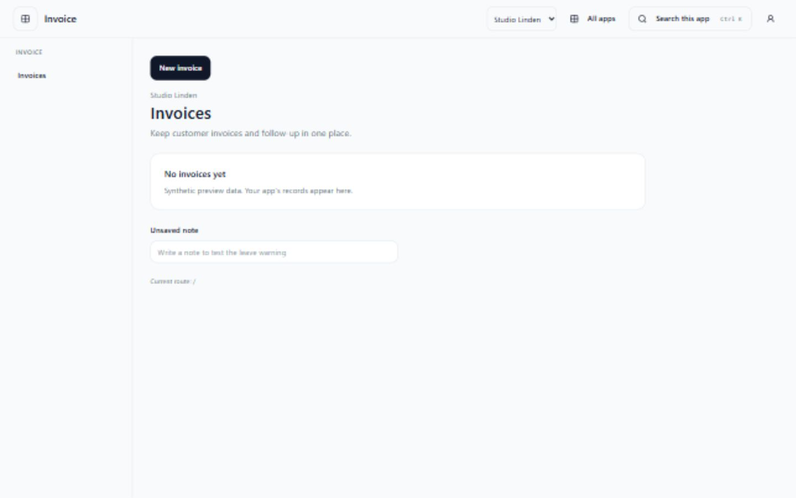
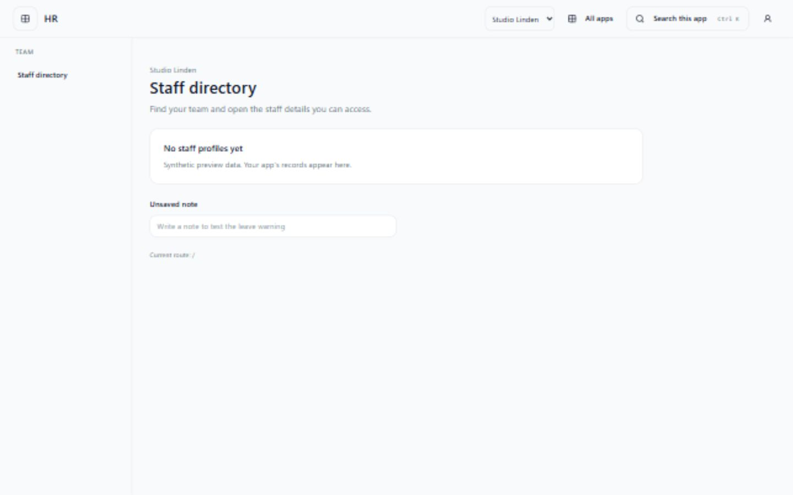
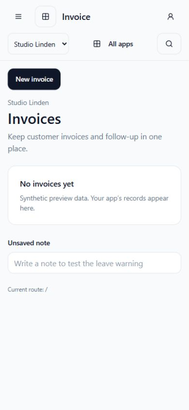
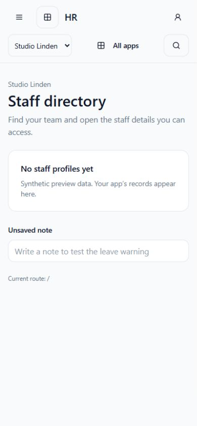
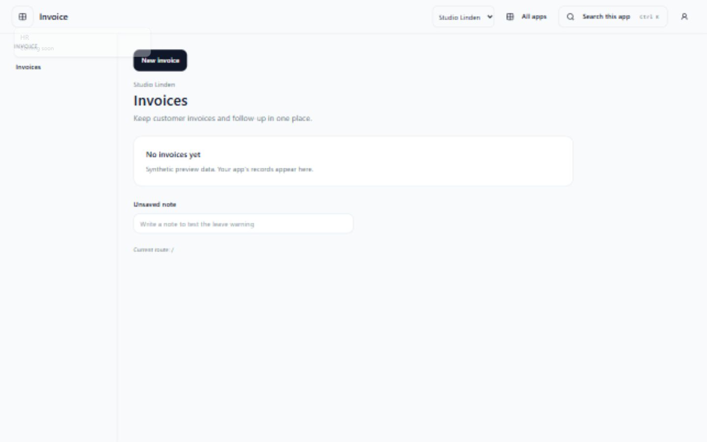
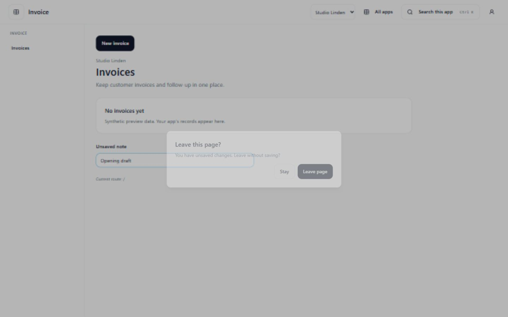
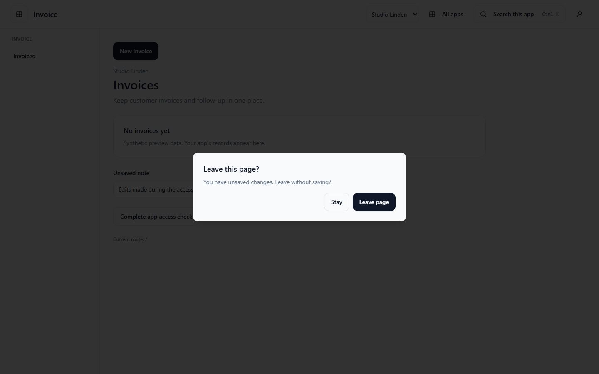
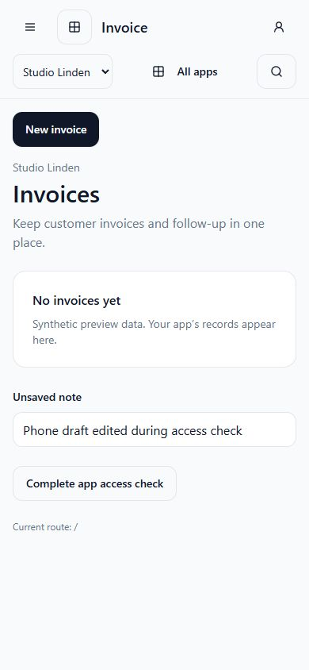

# Focused app shell

`FocusedAppShell`, exported by `@corely/web-shared`, supplies focused clients with
app identity, workspace/account controls, All apps, an app switcher and responsive
navigation. Existing clients retain `AppShell`. This component does not deploy
Invoice, HR or App Center; see [the surface decision](../decisions/ADR-0003-focused-app-surfaces.md).

## Client composition

Mount inside a router and `SessionProviders`, with the selected tenant and
workspace bound to the session. Routes and screens remain owned by the client and
public feature exports. Supply approved route roots and a configured App Center
origin:

```tsx
<FocusedAppShell
  app="invoice"
  label="Invoice"
  routeRoots={["/invoices", "/audit"]}
  appCenterOrigin={appCenterOrigin}
  workspace={authorizedWorkspace}
  isDirty={hasUnsavedChanges}
>
  <Outlet />
</FocusedAppShell>
```

The shell loads existing workspace config with `launchId` through the session
transport. Its app/workspace must match the session before loading data; unscoped
or mismatched projections expose no links or feature content. Query keys include
user, tenant, workspace and app. The client must resolve incoming workspace hints
and rebind its session through the workspace owner. The shell chooses no fallback.
Broader cross-tab/cache/queued-write behavior belongs to SURF-10 (#390).

Approved roots narrow the server-granted menu contributions. Sidebar, settings,
commands and search use that same set. Optional `actions` supply a label, relative
route and owning `menuItemId`; they only appear with that menu item and an approved
route. Clients must also apply operation-specific grants to action contributions:
a list menu item does not grant create/update permission. Backend authorization
remains mandatory.

`workspaces` and `onWorkspaceChange` optionally expose choices resolved by the
workspace owner. The handler must validate selection and rebind `SessionProviders`
before rendering the next workspace. Without a handler, the selector is disabled.
Set `isDirty` from the active form: shell navigation, workspace selection, launches
and sign-out then ask before leaving. Browser reload/close also warns. Forms own
navigation initiated outside the shell and their draft recovery.

`locale` selects English, German or Vietnamese shell controls. Feature labels and
the existing command-palette copy retain their owning localization. Manual
navigation does not depend on AI availability.

## Staff launch projection

Authenticated `GET /menu/launches` reuses `ListAppCatalogUseCase` and existing menu
composition for each catalog launch. Only destinations with accessible menu
contributions are returned after workspace resolution, grants, entitlements,
dependencies and capabilities. The administrative catalog's
`platform.apps.manage` requirement is unchanged. Reading never enables an app.

Only enabled, available destinations with valid exact origins can launch. Other
returned destinations show unavailable reasons. The switcher refreshes the
projection before navigation, then checks the current form's dirty state. Pending
leave confirmations are discarded when their route, session, granted navigation,
workspace choices or launch availability changes. App origins come from the server and App Center's
origin from deployment configuration; neither comes from query parameters.
`buildWorkspaceLaunchUrl` adds only an encoded `workspaceId` hint, carrying no
credential, tenant identity or arbitrary return path. The destination must
revalidate access. Current Coming soon flags remain unchanged.

## Review preview and evidence

Run `pnpm exec vite --config packages/web-shared/testkit/browser/vite.config.ts`.
Open `http://127.0.0.1:5186/?shell=true`, or add `&app=hr`. These are synthetic
session/workspace/menu responses, not deployed apps or database-backed journeys.
`&menu=loading`, `&menu=empty`, `&menu=error` and `&locale=de` / `&locale=vi` expose
review states. A note tests dirty-form confirmation. The preview workspace-change
handler is inert.

Checked 2026-11-09 at 1440×900 and 390×844: Invoice/HR layouts, mobile drawer,
keyboard commands and focus return, disabled launches, loading/empty/error,
localized shell controls, dirty-form cancellation and confirmed All apps navigation
with the workspace hint. Screenshots contain synthetic data only.

| Invoice desktop                                              | HR desktop                                         |
| ------------------------------------------------------------ | -------------------------------------------------- |
|  |  |

| Invoice phone                                             | HR phone                                        |
| --------------------------------------------------------- | ----------------------------------------------- |
|  |  |





### Launch race regression

Add `&launchReview=true` to the Invoice preview to expose a deterministic delayed
access check. Select HR while the note is empty, type a note, then press
**Complete app access check**. The confirmation must appear; **Stay** preserves
both the note and route. This was checked at 1440×900 and 390×844 after the review
correction. The completion button and launchable HR response exist only in this
synthetic fixture; runtime catalog availability is unchanged.




