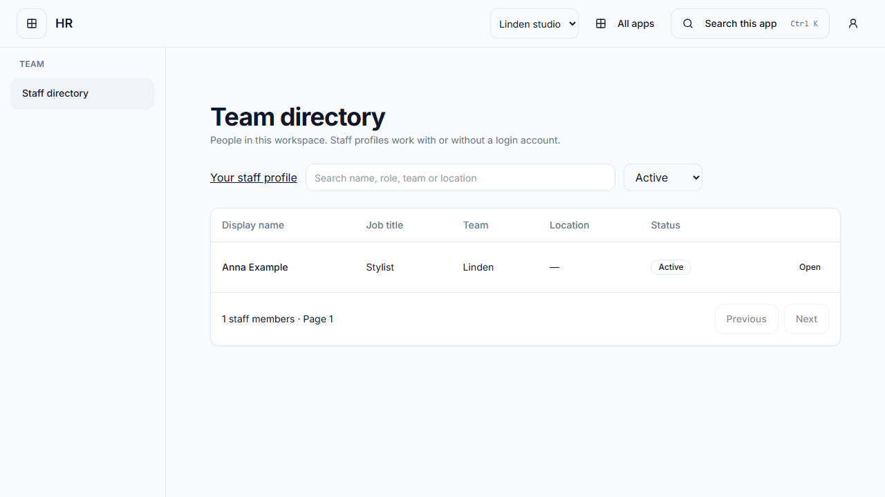
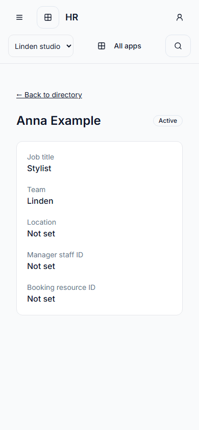
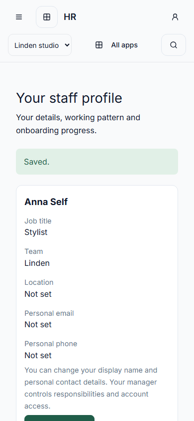
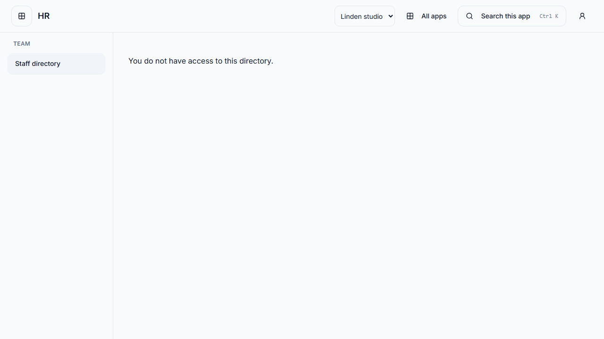

# Focused HR client

`apps/hr` composes the existing People public exports with the shared host-session
transport, workspace gate and focused shell. The runtime app ID stays `people`;
`hr` is the launch/session key. No second personnel owner, database, migration or
account model is introduced. The HR tile remains `coming-soon` pending #398 and
the rollout gates.

The directory, profile create/edit, working patterns, authorized private absence
and document controls, staff self-service and lifecycle routes reuse the current
People controllers and permissions. `/people/me` is also a permission-filtered
menu entry. HR does not mount Tasks, Invoice or Accounting routes; lifecycle task
summaries remain the existing People projection, with unrelated local task links
removed. Unsupported payroll/settings/assistant screens are absent.

Focused API factories receive an immutable session client, capture workspace
identity, preserve command retry keys and let the transport supply identity/CSRF.
Legacy clients keep their existing APIs and providers. Personnel responses stay in
mounted memory; account/workspace changes unmount the scope. Links preserve the
validated workspace ID, including open-in-new-tab URLs. Form drafts and pending
commands use the existing shared navigation guard.

The BFF now exposes the exact read-only `/identity/permissions/effective` endpoint
for UI permission discovery. It does not expose role administration. Owning API
use cases still enforce current permissions and workspace membership.

## Run and verify

Use [local focused setup](../guides/LOCAL_FOCUSED_SURFACES.md), then `pnpm dev:hr`.
It serves the actual HR client with login through the configured HTTPS gateway;
private API/proxy settings stay server-side. The standalone Vite development port
is 8097. Production DNS/proxy/session registration remains #399; this PR deploys
nothing.

```sh
pnpm --dir apps/hr typecheck
pnpm --dir apps/hr build
pnpm --dir packages/web-features exec vitest run --config vitest.config.ts src/modules/people
pnpm --dir apps/e2e exec playwright test --config playwright.hr.config.ts
```

The dedicated browser suite uses synthetic route responses, not a real issuer or
production personnel data. Database-backed People and host-session suites run
separately against test-owned local PostgreSQL. They do not establish a complete
browser-to-database journey. Cross-origin privacy/revocation acceptance remains
#398/#401, and full language/accessibility acceptance remains #402.

## Rendered evidence

English, synthetic account and records, 1280×720 desktop / 390×844 phone.
Inspected directory/profile layout, restricted access, self-service saved state,
scoped links and absence of unrelated sidebar routes. Browser interactions cover
manager save, staff self-edit, refresh, error/empty states and invalid workspaces.








