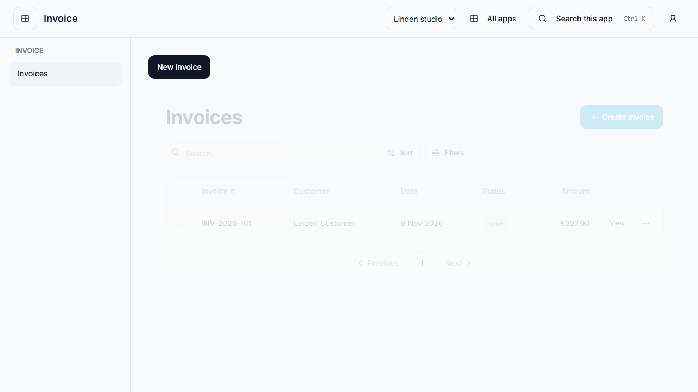
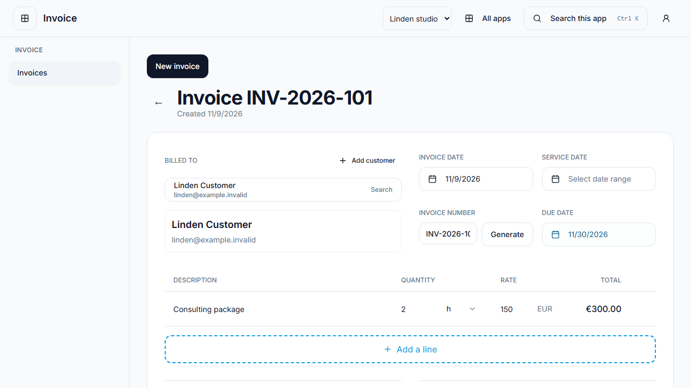
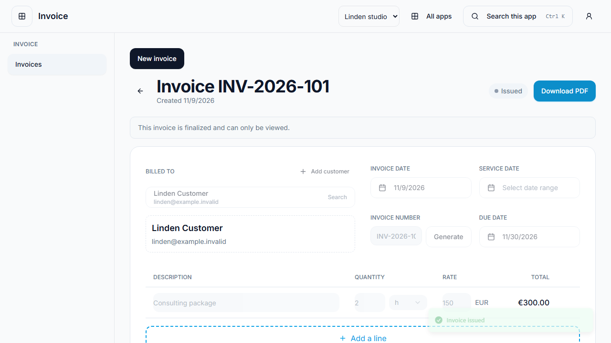
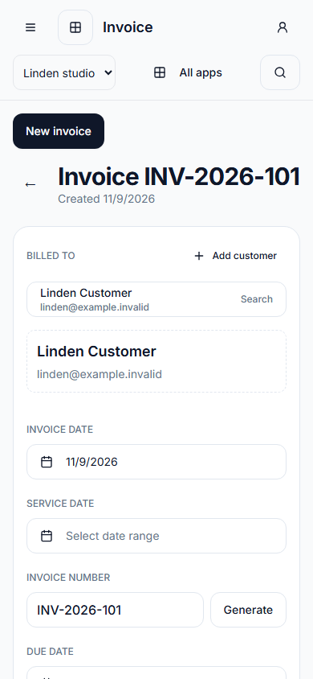
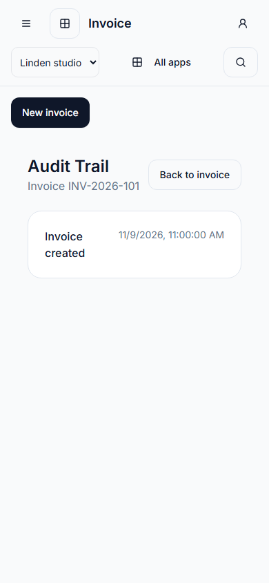
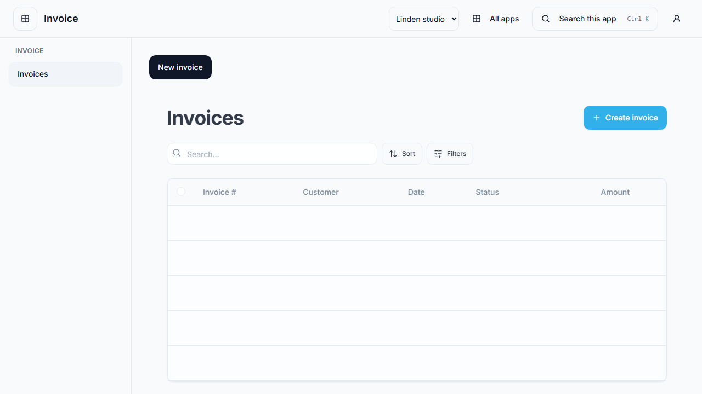
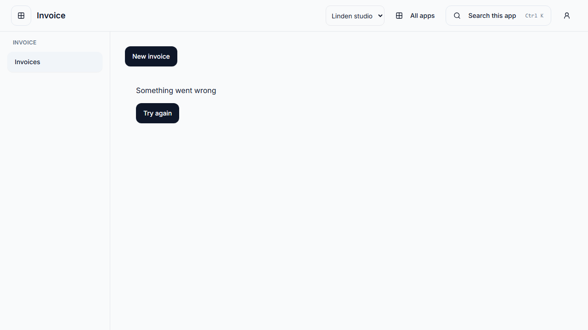

# Focused Invoice client

`apps/invoice` composes the existing public `invoicesRoutes()` feature export with
`WorkspaceSessionProviders` and `FocusedAppShell`. It introduces no invoice records,
DTOs, numbering service, money rules or accounting ledger. Existing Web/Freelancer
clients retain their providers and default API façades. Production host routing,
legacy link migration and rollout remain separate work (#399, #396, #404).

## Run and build

Complete the [local HTTPS setup](../guides/LOCAL_FOCUSED_SURFACES.md), including the
developer-owned API/database prerequisites. Then run in separate terminals:

```sh
pnpm dev:focused:api
pnpm dev:invoice
```

Open `https://invoice.app.corely.test:8443/invoices?workspaceId=<authorized-id>`.
The root runner starts only login and Invoice; App Center/HR clients need not run.
The shared private configuration supplies registrations and the public App Center
destination. `pnpm build:invoice` builds login and Invoice through that same runner;
`pnpm --filter @corely/invoice build` builds only this client.

`VITE_CORELY_APP_CENTER_ORIGIN` is a required, validated public destination. Missing
or invalid configuration displays a setup error before feature requests. Never
put API, database, OAuth or proxy secrets in browser variables. Direct HTTP Vite
development on port 8096 is useful for route-mocked tests; real cookie sign-in
uses the trusted HTTPS gateway. The Vercel fallback preserves client bookmarks
but deliberately excludes reserved API/callback paths; #399 must bind those paths
before any hosted activation. No deployment is performed by this ticket.

## Routes and access

| Route                                 | Behavior                                                              |
| ------------------------------------- | --------------------------------------------------------------------- |
| `/`                                   | Redirects to `/invoices`, retaining the workspace hint.               |
| `/invoices`                           | Existing list, search/filter, empty/loading/error states.             |
| `/invoices/new`                       | Existing create form and owning create/finalize APIs.                 |
| `/invoices/:id`, `/invoices/:id/edit` | Existing detail/editor and capabilities.                              |
| `/audit?entity=invoice&id=…`          | Existing invoice-record activity projection, not global audit search. |
| Other routes                          | Invoice not-found state; no HR, Tasks or Accounting screen mounted.   |

Workspace intent remains per-tab URL state. Membership discovery, bound session
bootstrap and Invoice app access complete before screens mount. Feature links,
sidebar links, creation and Back navigation preserve the validated workspace.
Active forms register draft guards; successful saves clear the guard before
navigating. Each record route remounts the editor rather than carrying a draft to
another invoice. Old bearer tokens or global active-workspace storage do not
retarget requests. Focused list filters do not persist to the legacy global key.

`InvoiceRuntimeProvider` injects instance-scoped façades into the same screens.
`SessionFeatureHttpClient` maps their existing typed HTTP port onto SessionClient,
including same-origin cookies, CSRF, tenant/workspace headers, command identity,
cancellation and no retry/replay. Legacy consumers default to their existing
client. Query keys include user, tenant, workspace, app and resource in the focused
runtime; a fresh scoped QueryClient also prevents hydration of former contexts.
The backend retains every operation permission, app-enable/capability and record
ownership check. Showing a route or action grants no API authority.

Focused PDF downloads leave payment defaults to the owning Invoice finalize/PDF
use cases. They do not call the legacy payment-settings API, which the Invoice
BFF intentionally excludes. Legacy clients retain their existing setup flow.
PDF navigation preserves `noopener,noreferrer`; a null `window.open` result with
those flags does not establish that the browser blocked the new window.

Invoice activity reads only the authorized invoice record and its existing
timestamps/payments. Invalid entity targets make no record request, and there is
no global audit endpoint/query mounted here. This is not a complete event ledger.

The focused create header uses the selected workspace name instead of the old
Freelancer-specific placeholder address. Existing invoice number previews and
form-to-contract conversion are reused; actual numbering remains server-owned.
An unnumbered draft receives a non-authoritative editor preview so form validation
does not prevent saving it. No number preview is added to the command DTO.
Date-only values parse as local calendar dates so saving west of UTC does not
silently shift the invoice or due date backwards.

## Supporting workflows and assistant boundary

Invoice lists and details use the authorized invoice's billing snapshots. The
invoice-read endpoint does not enrich that data with a live full customer record;
customer access remains a separate permission. Opening the inline customer picker
uses the existing customer search API with `role=CUSTOMER`, server search and cursor
pagination. Loading, empty and failed lookups are distinct; an explicit retry does
not invent an empty customer list. A new customer stays selected after inline
creation. Queries remain scoped to the verified user/tenant/workspace/app.

The existing Invoice Copilot panel is available on the detail screen. It calls
only the two invoice-owned draft endpoints with the active session context. It
can draft/edit/copy email text, with no generic tool runner or automatic send.
Both endpoints now enforce the Invoice app entitlement as well as invoice-read.
The owning use cases re-read the workspace's invoice and validate status/due
amount before generation; the existing audit and rate limit remain in place.

Invoice opts into request-local service failures (network errors, 429 and 5xx),
so an optional assistant outage does not remove the manual editor/send flow.
401/403 still invalidate the verified session and clear its scope. Other clients
retain the transport's default session-wide failure behavior. Failed commands
are never automatically retried. Outbound sending uses the separate review dialog
and existing issue permission, business-state validation and idempotency path.
Nonworking test-send and copy-to-self controls have been removed from that shared
dialog. No actual email delivery is claimed by the browser fixtures.

The Invoice BFF excludes generic document, search/tool and AI APIs. PDF access
continues through the invoice-owned endpoint; unrelated attachments/personnel
records are not exposed by a generic file browser. No Templates menu is added.

### Supporting entry-point inventory

| Entry point                         | Current focused behavior / limit                                                                                                                                           |
| ----------------------------------- | -------------------------------------------------------------------------------------------------------------------------------------------------------------------------- |
| Customer selection/creation         | Existing Party owner, read/manage permissions, inline dialogs and session transport; no CRM navigation required.                                                           |
| Currency/date/terms                 | Existing form and shared contracts; backend owns accepted values.                                                                                                          |
| Tax/numbering                       | Existing finalize behavior; editor previews are not authoritative and are not sent as numbering/tax policy. No numbering-policy editor is added.                           |
| Business identity/contact/tax setup | Existing workspace/legal-entity owner supplies invoice snapshots. The legacy settings footer remains outside this client.                                                  |
| Payment setup                       | Existing owner-side defaults; no broad payment-settings API is opened. Its legacy controller lacks the operation/workspace guards required for a focused configuration UI. |
| PDF/download                        | Existing invoice permission/capability and owner-side document generation.                                                                                                 |
| Delivery                            | Reviewed send dialog, existing outbound use case; optional assistant drafting never sends.                                                                                 |
| Activity                            | Invoice-only timestamps/payments; not a global audit browser.                                                                                                              |

Configuring business identity/payment policy from within Invoice remains a known
setup limitation, not a claim of an available focused settings screen. Those
legacy settings cannot safely be enabled by adding a menu or widening the BFF
allowlist. This delivery preserves the currently supported invoice flow and does
not promote #353/#355, create a new settings owner, or claim tax compliance.

Supporting-workflow execution and visual evidence are recorded in
[the #395 task record](../tasks/395-invoice-supporting-workflows.md).

## Verification and UI evidence

```sh
pnpm --filter @corely/invoice typecheck
pnpm --filter @corely/invoice build
pnpm --dir packages/web-shared exec vitest run --config vitest.config.ts
pnpm --dir packages/web-features exec vitest run --config vitest.config.ts src/modules/invoices
pnpm --dir apps/e2e exec playwright test --config playwright.invoice.config.ts
```

The standalone Playwright configuration starts the actual Invoice Vite client
on loopback port 5188 with synthetic session/API responses. It covers list,
bookmark/reload, detail/edit, create/finalize and update command bodies, invoice
activity, loading/error recovery, empty/missing/denied states, unrelated routes,
stale token/storage isolation and dirty navigation. General/API configurations
exclude this fixture-specific suite; run it explicitly.

The PDF regression supplies contract-validated action capabilities and a draft
without a payment method. It verifies finalize/PDF requests without forbidden
settings calls, secure popup navigation and absence of a false popup error.

Separately, the existing `focused-api-access.int.test.ts` and
`sso-session-transport.int.test.ts` suites were run against a newly created,
loopback-only disposable PostgreSQL database. They execute real HTTP adapters,
authorization/session use cases and persisted records where those suites provide
them; some transport/business collaborators remain test doubles. This verifies
API permission/workspace boundaries, not a full browser-to-database create flow.
See [SSO test setup](../backend/sso.md#reproduce-isolated-checks) for the isolated
`corely_384_*` database guard. No shared database or real email was used.

The list/detail/create comparison uses the same exported components, API paths
and form-to-contract conversion as the retained clients. Existing Invoice Copilot
component tests were rerun. A separately running full legacy client was not
visually compared in this session; screenshots below show the focused composition.
No production readiness is inferred from source reuse or mocks.

Rendered states were visually inspected in English at 1280×720 and 390×844.
Phone inspection exposed a shared fieldset/metadata overflow; it was corrected
with a zero minimum fieldset width, stacked phone fields and responsive padding.
The browser suite also asserts no horizontal overflow in the phone editor.
EN/DE/VI feature translations are reused; this is not a complete localization
audit. New surface-specific setup/not-found copy is currently English; #402 owns
the broader focused-client localization/accessibility verification.







| Phone editor                                                        | Invoice-record activity                                                       |
| ------------------------------------------------------------------- | ----------------------------------------------------------------------------- |
|  |  |

| Loading                                                             | Request failure                                                      |
| ------------------------------------------------------------------- | -------------------------------------------------------------------- |
|  |  |


