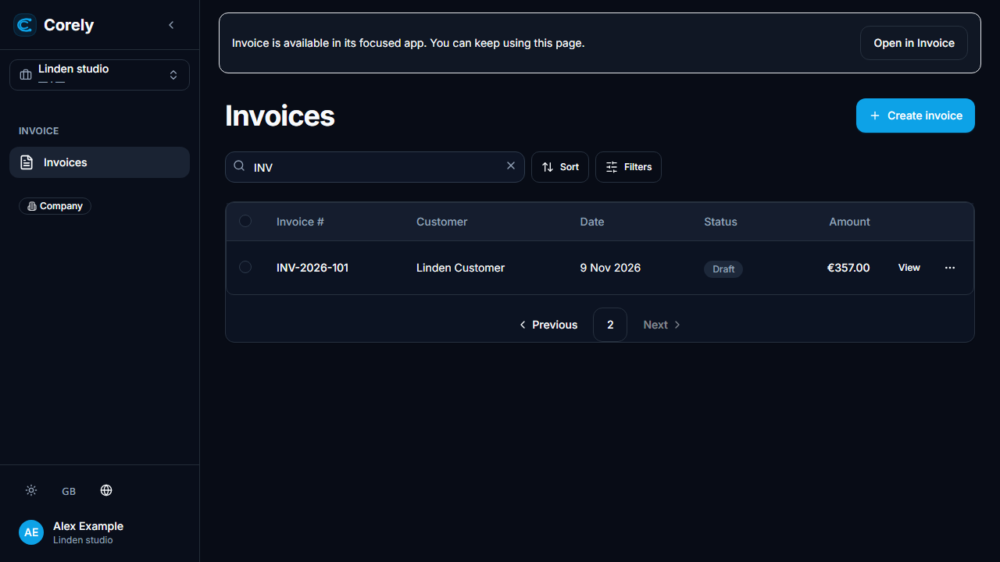
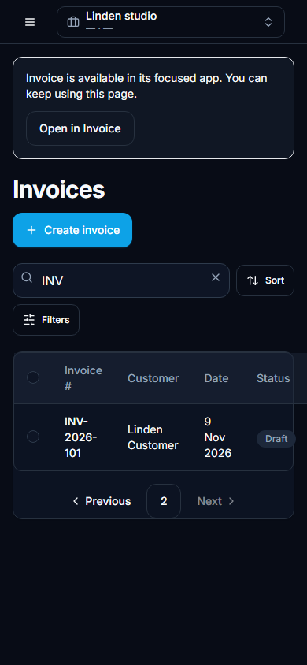

# Legacy Invoice links and reversible handoff

The administration client retains its existing Invoice routes. A build-time
workspace cohort can opt into an explicit **Open in Invoice** link; there are no
automatic or permanent redirects. Disabling the flag restores the old presentation
without changing invoice records, APIs, cookies or routes. Other clients do not
mount this boundary.

## Configuration and behavior

Set the public web build values in the root environment consumed by the web Vite
configuration, or in the deployment build environment:

```dotenv
VITE_CORELY_INVOICE_LINK_MIGRATION=true
VITE_CORELY_INVOICE_LINK_WORKSPACES=approved-workspace-id,another-approved-workspace
```

Default is `false` with an empty cohort. Missing/malformed configuration, an
out-of-cohort workspace, unavailable/disabled catalog launch or catalog error
produces the retained legacy page without a handoff link. Rollback: rebuild the
legacy web artifact with the flag `false` and restore that artifact through the
approved deployment process. This change performs no deployment/cutover.

The link resolves the authorized `/menu/launches` descriptor for the currently
selected account/tenant/workspace. Its destination is never taken from a query
parameter. A conflicting or duplicated workspace hint does not fall back to a
different workspace. The focused destination independently discovers and verifies
the workspace after central sign-in; invalid resources remain its API's denied or
not-found flow rather than redirecting to App Center.

`buildInvoiceDestinationLink` in `@corely/web-shared/session/invoice-links` is the
shared staff link-generation helper for future cards/notifications. It maps only:

| Legacy route                    | Focused destination                        |
| ------------------------------- | ------------------------------------------ |
| `/invoices`                     | Invoice list with approved list state      |
| `/invoices/new`                 | Existing create flow                       |
| `/invoices/:id` and `/:id/edit` | The same invoice ID and view               |
| `/audit?entity=invoice&id=:id`  | Existing invoice-owned activity projection |

Supported query state is bounded `q`, positive page/pageSize, recognized invoice
sorts and shared-contract filters on status/number/issuedAt/customerPartyId.
Credential, tenant/user, arbitrary redirect and unknown query parameters and URL
fragments are omitted. Public Invoice/payment/token routes, portal workspace
paths and unrelated routes are excluded.

## Producer inventory

| Existing producer                                                               | Compatibility decision                                                                                                                                                                                                                                             |
| ------------------------------------------------------------------------------- | ------------------------------------------------------------------------------------------------------------------------------------------------------------------------------------------------------------------------------------------------------------------ |
| Administration router, sidebar, dashboard, tax source drilldowns and invoice UI | Existing staff paths remain valid; the web route boundary resolves the explicit focused link. No screen or domain duplication.                                                                                                                                     |
| Focused Invoice screens and shell                                               | Already produce scoped local links; retain their per-instance runtime.                                                                                                                                                                                             |
| Customer invoice email handler                                                  | `invoice-email-requested.handler.ts` builds portal workspace `/invoices/:id` URLs. These are customer journeys, not staff links; preserve portal auth and origins.                                                                                                 |
| Invoice public-link HTTP endpoints                                              | Keep their public tokenized `/invoices/public/...` routes; never pass tokens to staff launch URLs.                                                                                                                                                                 |
| Notifications and assistant cards                                               | No independent staff Invoice URL producer found in the reviewed notifications/assistant modules. Future staff producers use the shared helper after resolving an authorized descriptor/workspace; generic imported hrefs are not promoted to trusted destinations. |
| OpenBuk, portal, public booking, POS, freelancer/CRM/cash clients               | No handoff wrapper or global redirect introduced.                                                                                                                                                                                                                  |

`app.corely.one` retains its existing application binding until the approved
[host cutover](../decisions/ADR-0003-focused-app-surfaces.md). Non-Invoice platform
pages keep their existing host/path. The proposed compatibility alias remains
unprovisioned; #399/#404 must verify actual bindings and rollout/rollback.

## Verification and evidence

18 pure mapping/cohort tests passed. Three real database-backed central sign-in
round trips retain detail/edit, list query and invoice activity/workspace intent.
The actual legacy web browser suite runs both opted-in and disabled builds with
synthetic legacy/API responses: the original Invoice row still renders, no
navigation occurs automatically, approved links retain workspace/query state,
and a conflicting workspace removes the handoff. This is not a complete live
browser-to-database or deployment test.

English, synthetic data; desktop 1280×720 and phone 390×844, visually inspected.




