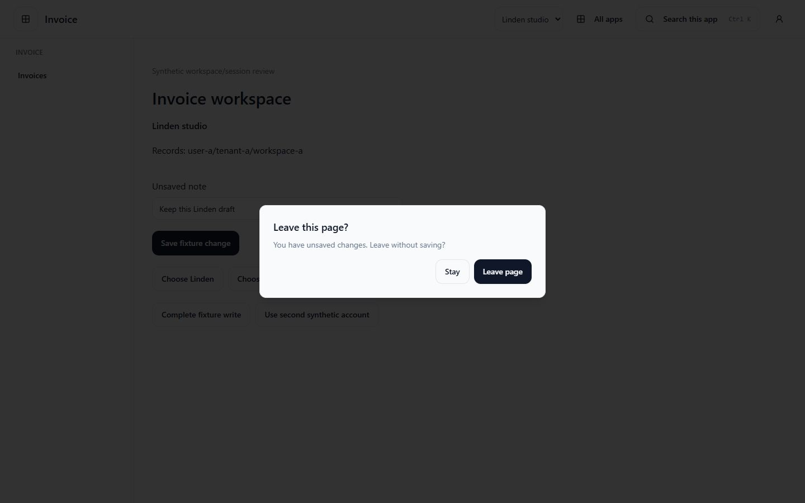
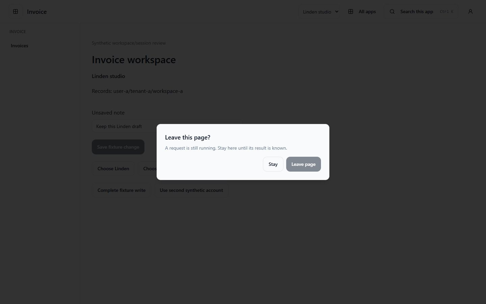
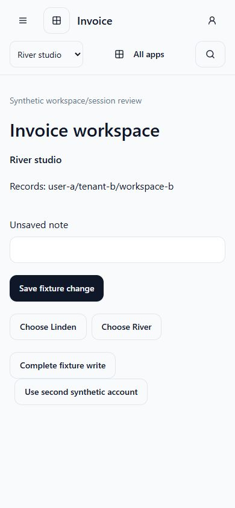
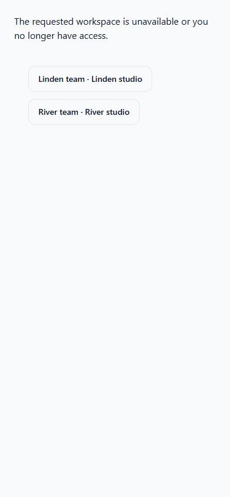

# Workspace handoff and browser isolation

Focused clients opt into `WorkspaceSessionProviders` from `@corely/web-shared`.
It resolves workspace intent before mounting feature queries, using existing
Identity sessions, Workspaces discovery/authorization and app-scoped menus.
It does not create a new identity, workspace owner, persistence schema or app
deployment. Legacy providers and their global workspace store remain unchanged.

## Compose the arrival boundary

Mount the provider as a **React Router data-router route element**. Its blocker
guards PUSH navigation and browser Back/Forward; a plain `BrowserRouter` does not
provide that blocker API. `homePath` is the app-owned local landing route to open
after an explicit workspace selection, avoiding accidental reuse of a record edit
URL in another workspace.

```tsx
const router = createBrowserRouter([
  {
    element: (
      <WorkspaceSessionProviders appKey="invoice" homePath="/invoices">
        <InvoiceLayout />
      </WorkspaceSessionProviders>
    ),
    children: invoiceRoutes,
  },
]);
```

An authenticated profile supplies tenant memberships. Discovery verifies each
tenant through the existing session transport and calls the owning membership-
filtered `/workspaces` list. A change of account during discovery aborts selection.
Only a unique matching workspace ID supplies the tenant/workspace binding.

The resulting session bootstrap revalidates that binding server-side. Invoice/HR
then check their existing scoped workspace configuration; App Center checks its
staff launch projection. Feature children remain unmounted until access succeeds.
An absent hint asks for a choice. Malformed, repeated, inaccessible or deleted
hints never choose a fallback or issue feature requests. No available navigation
for the focused app produces an explicit unavailable state and recovery choices.

`useWorkspaceSession()` supplies the verified `workspace`, authorized `workspaces`,
full `scope` and `selectWorkspace`. Pass those values to `FocusedAppShell`.
The shell cooperates with the router guard so a registered draft prompts once.

## URL and tab behavior

`buildWorkspaceDeepLink(destination, origins, workspaceId, relativeRoute?)` accepts
only configured `app-center`, `invoice` and `hr` destinations. Each origin must
pass the existing exact-origin policy; HTTP is restricted to loopback development.
The relative route must be safe and canonical. Identity/credential/return-URL
query overrides and credential-style fragments are rejected. Only the encoded
`workspaceId` hint is added; no tenant identity or token is handed off.

The current tab's URL is its workspace intent. Selection writes no global active-
workspace value and subscribes to no legacy workspace-storage events. Switching
another tab cannot retarget an open form. Actual authority always comes from the
receiving server, not the URL, remembered state or a prior discovery result.

## Drafts, commands and caches

Active forms call `useWorkspaceDraftGuard(isDirty)`. A dirty route/workspace change
offers **Stay** or explicit discard. Stay keeps the original route and form;
discard permits navigation, where the next scope starts with fresh state. Browser
reload/close also warns. Account revocation/changes conceal and discard the former
account's mounted private state; drafts are never copied to a different account.

Session transport tracks commands through response-body consumption. The boundary
also observes React Query mutations. In-app navigation and cross-app launch cannot
proceed while a write is pending. Once its result arrives, leaving still requires
an explicit decision. Feature commands retain their owning authorization and
idempotency requirements; a lost response must be reconciled in its original
workspace before a manual retry.

Each selected account/tenant/workspace receives a new QueryClient. Session disposal
aborts old requests and rejects late responses. `sessionScopeQueryKey(scope,
resource, ...parts)` includes user, tenant, workspace, app and resource for feature
queries; the shell uses this shared key format. Focused sessions **do not hydrate
persisted legacy query caches or outboxes**. Offline commands attempt once and
fail; they are not paused, queued or replayed on reconnect under another scope.

For an explicitly retired legacy origin, keep the existing
`retireLegacyStorage` migration option. Outstanding ownerless outbox work is
preserved and blocks migration for manual recovery. This ticket adds no offline
command engine, migration of payloads between users or persistent draft store.

## Verification and UI evidence

Run the standalone, loopback-only browser suite:

```sh
pnpm --dir apps/e2e exec playwright test --config playwright.workspace-session.config.ts
```

It starts its own Vite fixture on port 5187. Three distinct `.localhost` origins
exercise App Center → Invoice → HR → App Center, two users, two tenants and two
workspaces. Browser tests cover tampered/deleted hints, app denial, dirty Back
navigation, cross-tab storage changes, delayed responses, account changes,
pending writes and failed-command non-replay. Session/API responses are route
mocks; this proves browser orchestration, not live cookies, TLS or database access.
Separate tests execute the real session/context/workspace authorization use cases
with repository-port doubles, including cross-scope and revoked-membership denial.
No database-backed SSO run or deployment readiness is claimed.

For manual inspection, run
`pnpm exec vite --config packages/web-shared/testkit/browser/vite.config.ts` and
open `http://127.0.0.1:5186/workspace-session/invoice?workspaceId=workspace-a`.
The explicit local preview uses synthetic transport data. Type a note, choose
River, then Stay; save a fixture change to hold a write, try to switch, and use
**Complete fixture write** after staying. `workspaceId=foreign` exercises recovery;
`/workspace-session/hr?workspaceId=workspace-b&user=user-b` exercises app denial.
These controls exist only in the test fixture.

Inspected 2026-11-09 in English at 1440×900 and 390×844: dirty confirmation,
pending-write lock, explicit cross-tenant switch, empty new draft and unavailable
hint recovery. Screenshots contain synthetic data only.





| Verified River workspace                                                         | Unavailable hint recovery                                                                    |
| -------------------------------------------------------------------------------- | -------------------------------------------------------------------------------------------- |
|  |  |
