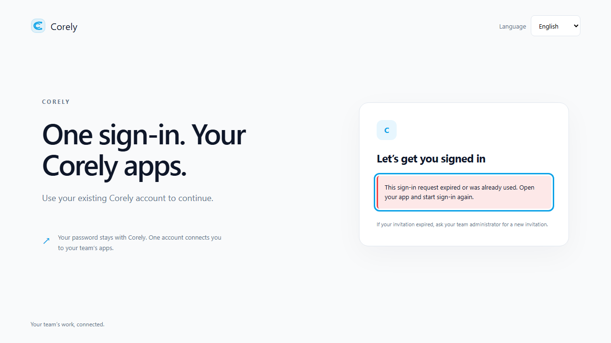

# Local focused-surface development

The #391 tooling runs one loopback HTTPS ingress in front of the existing Corely
API and selected Vite clients. Corely Identity remains the self-hosted login owner;
no commercial provider, separate identity database or production cookie exception
is required. Read [central login](../backend/sso.md) and
[host sessions](../backend/host-sessions.md) for the actual protocol.

## Current delivery boundary

`apps/login` exists. App Center, Invoice and HR client composition belongs to
#392, #394 and #397; these directories are not scaffolded by the development
tooling. The default command refuses missing clients instead of serving a different
product. `--probe` deliberately substitutes a labeled transport probe for those
three hosts while retaining the real login frontend and API ingress. It verifies
the developer topology, not the future feature screens or their readiness.

## Clean setup

Use the repository's pinned pnpm and Node 22.19+:

```sh
pnpm install --frozen-lockfile
pnpm focused:init
```

Initialization exclusively creates ignored `.env.focused.local`, with fresh random
server-only encryption/proxy keys. It refuses to overwrite an existing file.
`.env.focused.example` contains placeholders only. Never copy these private values
into `VITE_*`, frontend `.env` files, issue comments or logs. The root API retains
its existing private `.env` database/storage/mail settings.

Install `mkcert` using your platform's package manager, then explicitly trust its
local CA and generate a certificate with these four SANs. Trust installation is a
local administrator action; the scripts never install a CA or edit the hosts file.

```sh
mkcert -install
mkdir -p local/focused
mkcert -cert-file local/focused/cert.pem -key-file local/focused/key.pem login.corely.test app.corely.test invoice.app.corely.test hr.app.corely.test
```

On PowerShell replace `mkdir -p` with
`New-Item -ItemType Directory -Force local/focused`. The ignored `local/` directory
holds private keys; do not commit certificates or your CA. Add this line to your
OS hosts file (`/etc/hosts` or Windows
`C:\Windows\System32\drivers\etc\hosts`) using an administrator editor:

```text
127.0.0.1 login.corely.test app.corely.test invoice.app.corely.test hr.app.corely.test
```

No wildcard DNS is required. Restart the browser after installing trust. Do not
disable browser certificate checking for interactive development.

```sh
pnpm focused:check
pnpm dev:focused:api
```

Run the second command in a dedicated terminal. It starts the existing `dev:api`
workflow with validated server-side registrations, proxy key, SSO encryption key
and launch origins; no secrets are printed. The API must already have a developer-
owned database with the reviewed Identity SSO schema and existing accounts, plus
its normal required service configuration. The tool runs no migration, reset,
seed or email send. SSO email-code delivery requires the existing sender/outbox
configuration; use password fallback for existing local accounts when testing
without sending mail. Enabling SSO still requires the API's configured Resend
sender at startup; a generic SMTP sandbox is not implemented by this tooling.
Do not request codes against live recipients during local transport checks.

The upstream is fixed to `http://127.0.0.1:3000` by the example. If using another
local API port, change `CORELY_DEV_API_ORIGIN` and the API's normal `PORT` together.
Remote origins, credentials and paths are rejected. Root API `.env` remains
server-only; it is never loaded into Vite by this tool.

In another terminal, run the currently available full-origin setup:

```sh
pnpm dev:focused --probe
```

| Surface    | Browser origin                         | Internal Vite port |
| ---------- | -------------------------------------- | ------------------ |
| Login      | `https://login.corely.test:8443`       | 8094               |
| App Center | `https://app.corely.test:8443`         | 8095               |
| Invoice    | `https://invoice.app.corely.test:8443` | 8096               |
| HR         | `https://hr.app.corely.test:8443`      | 8097               |

The gateway binds only `127.0.0.1`; it rejects unknown/inactive Hosts. Open an app
probe and choose **Check sign-in handoff**. Pre-auth/login/callback requests go to
the shared API; the central credential page comes from the real login Vite server.
Callbacks remain exactly `/auth/callback`; logout returns to `/auth/logged-out`.
Cookie names/flags are unchanged: Secure, HttpOnly, SameSite=Lax, Path=/, no Domain.
The proxy strips caller-supplied ingress/forwarded/authentication headers before
setting its private key and the fixed registered browser origin. It preserves the
caller's Origin header for the backend's mutation/CSRF checks. No cross-origin
credentialed fetch or browser token handoff is introduced.

Only reserved `/sso/*`, `/api/session/*`, `/api/bff/*` and exact callback/logged-out
paths reach the API. Other paths reach the selected Vite server (or explicit probe).
TLS terminates locally; the private loopback upstream uses the existing trusted-
proxy contract. Keep the API on loopback and never expose this developer gateway
to the internet. Production/staging routing belongs to #399.

## One client, build and configuration reuse

```sh
pnpm dev:focused --surface=login
pnpm build:focused --surface=login
```

The selection runs login plus the requested app, not every frontend. After a
focused client lands, `--surface=invoice` starts only login and Invoice against the
same API; omit `--probe` to require its actual app directory. `pnpm dev:focused`
and `pnpm build:focused` select all four and fail explicitly until all exist.
Existing `dev:web`, `dev:api`, `dev:openbuk` and focused legacy scripts are unchanged.
The integration runner disables HMR websocket injection; reload the browser after
an edit. Existing direct Vite commands retain their HMR behavior.

Convenience aliases `dev:app-center`, `dev:invoice`, `dev:hr` and corresponding
`build:*` commands use this same validated runner; they do not scaffold missing apps.

`packages/config/src/focused-surfaces.ts` is the shared local environment schema.
It validates required public destinations, distinct fixed hostnames/one TLS port,
same-origin BFF base path and private loopback upstream/key paths. Callbacks and API
registrations are derived from the same origins, not independently edited. The
runner injects only the five validated `VITE_CORELY_*` public fields and disables
automatic Vite environment exposure. Unexpected `VITE_*` variables fail validation.
`CORELY_DEV_ENV_FILE` selects another private file; process environment overrides
its values. Relative certificate paths are resolved from the repository root when
using the documented root commands.

## Reproduce verification

```sh
pnpm test:focused-dev
pnpm test:focused-dev:int
pnpm exec tsc -p scripts/focused-dev/tsconfig.json
pnpm --filter @corely/config typecheck
pnpm build:focused --surface=login
```

Unit tests need no certificate or API. Transport integration requires the generated
private config/certificate and starts test-owned loopback servers on random ports.
It does not contact your API/database or send email. It verifies fixed ingress
authority, spoofed-header stripping, callback query preservation, cookie forwarding,
unknown-host rejection and probe separation. Only this test client disables trust
verification for its generated certificate; the gateway never disables TLS checks.

[Focused local development CI](../../.github/workflows/focused-dev.yml) performs a
frozen-lockfile install, initialization, disposable certificate generation, checks,
login build and actual four-origin startup. Its self-signed certificate is never
installed in the runner trust store. This CI smoke uses probes and a test-owned
upstream, not real first-wave product screens or database-backed sign-in.

For the existing full database-backed browser SSO suite, retain the isolated
database requirements and commands in [central login](../backend/sso.md#reproduce-isolated-checks).
Its port 8444/disposable-certificate fixture is deliberately separate from this
developer's trusted port 8443 setup. It requires no live provider. No database-backed
pass is implied by a topology smoke or cookie-header assertion.

## Observed developer browser states

Inspected 2026-11-09 in Chromium at 1280×720, English, with normal certificate
validation enabled: the Invoice transport probe and the existing login page's
expired-request state. No credentials or messages were sent. These are developer
topology evidence, not delivered Invoice/App Center/HR feature flows.



