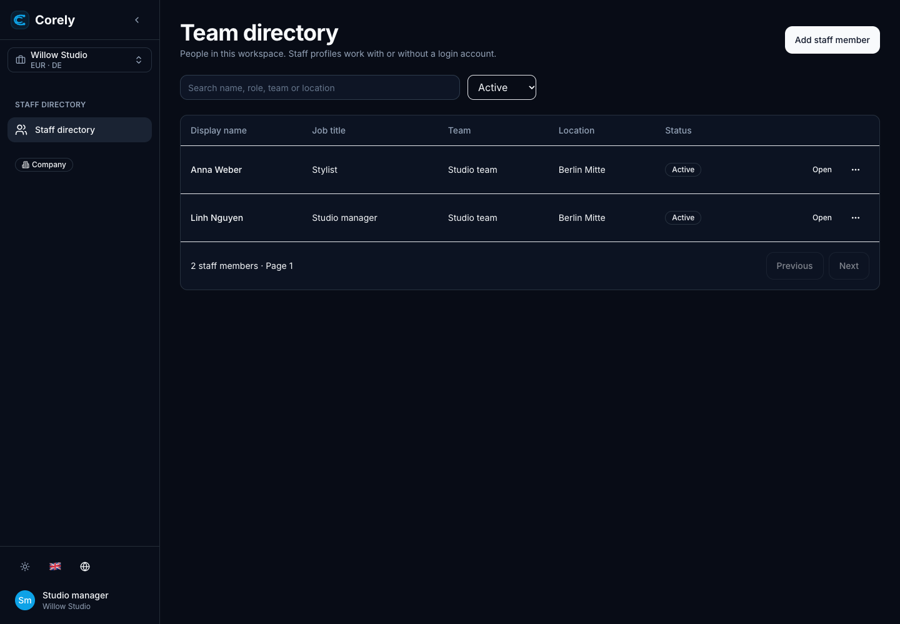
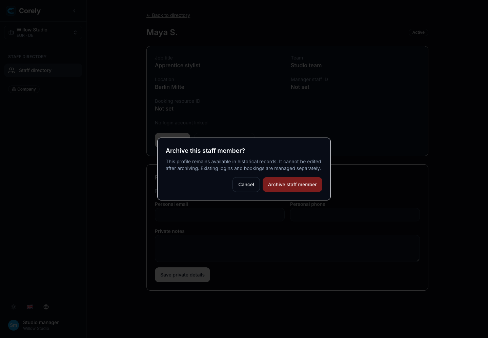
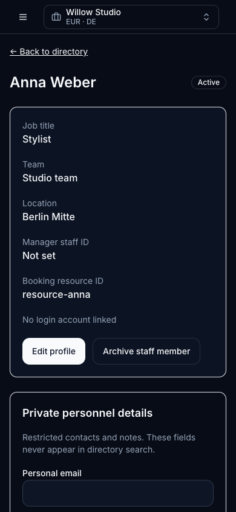
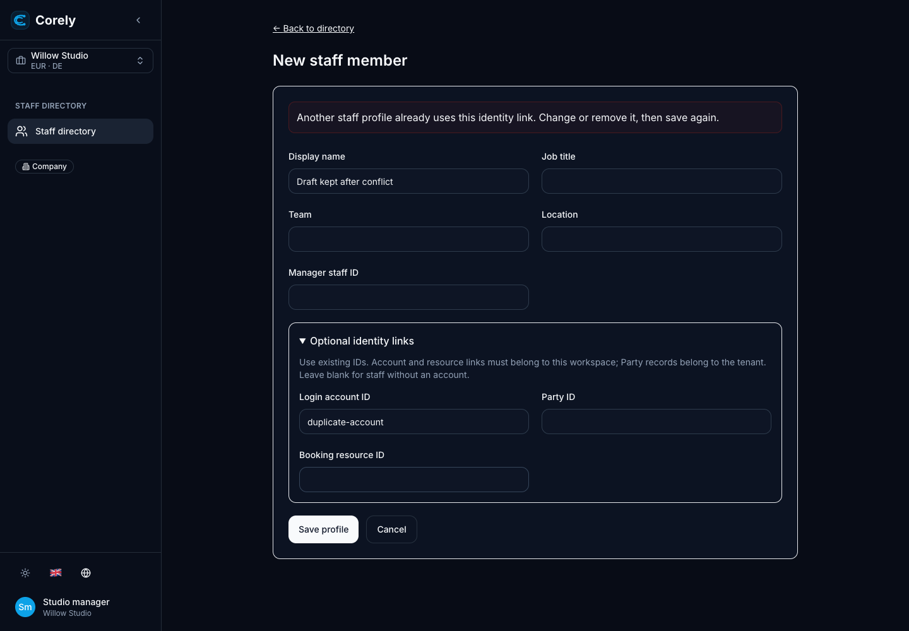
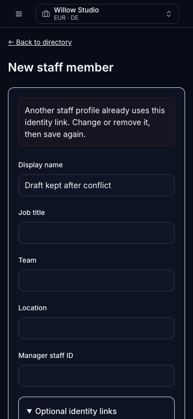
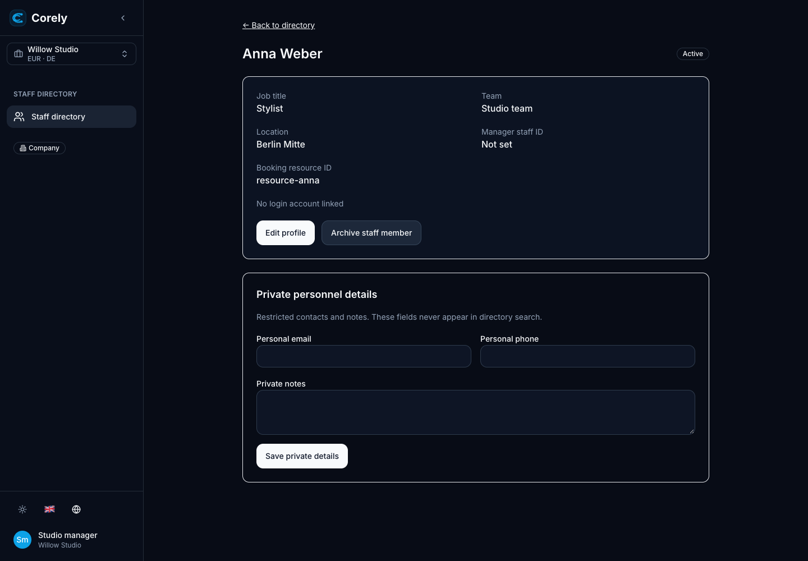

# 305 — Staff directory and explicit identity links

## Tracking and outcome

- Issue: [#305 / PEOPLE-01](https://github.com/Corely-AI/corely/issues/305).
- Parent: [#283](https://github.com/Corely-AI/corely/issues/283).
- Prerequisites: #298 and #302, both closed completed with their implementations merged.
- Branch: `305-staff-directory`; PR base: `development`, inspected `dac9007605` on 2026-11-07.
- PR: [Draft #373](https://github.com/Corely-AI/corely/pull/373).
- Outcome: managers maintain workspace staff records and optional validated links;
  staff read a neutral directory; private fields remain separately authorized.
- Excludes working patterns, absence, self-service/offboarding, exports/attachments,
  payroll, AI tools and new deployments.

## Reuse and decisions

Reviewed Identity User/Membership/permissions, Workspaces policy and client cache
boundary, Party, Booking resources, extension storage, audit/outbox adapters,
existing manifests/entitlements/menu composition, shared CRUD/UI and contracts.
No dedicated directory owner was found in those reviewed sources. Added the small
People owner using extension storage; existing owner records are not duplicated.
[Maintained behavior and policy](../backend/people.md) describes the precise field,
link, version, archive, persistence and permission boundaries.

Team/location remain bounded profile labels. Party is genuinely tenant-owned;
Identity membership and Booking resources have explicit workspace validation.
Archived links remain reserved for history. Archive does not revoke accounts or
cancel bookings. Backend permissions and app enablement are independent controls.
No private files, exports, audit retrieval or AI retrieval are exposed by this slice.

Browser verification found stale detail data after edit-to-detail navigation.
Navigation is now included in the load identity, with a component regression test.
Late responses and mutation callbacks cannot populate another scope; requests pin
the selected workspace before token refresh. Private DTOs never enter persisted
React Query caches. Audit/outbox payloads contain IDs/versions only.

## Verification

The table below records the initial delivery. Fresh review results are recorded
in the review section below.

Disposable PostgreSQL 16 cluster created specifically for this ticket on loopback
port 55435; database name `people_test_305`. All checked-in migrations applied with
`prisma migrate deploy`; no new migration, shared database reset, seed or real
message delivery. Integration tests require `PEOPLE_TEST_DATABASE_URL` with a
`people_test_*` database and never select the developer's default database.

| Command / check                                                                                                                                                                                                                                                                                                 | Actual result                                                                                                                                      |
| --------------------------------------------------------------------------------------------------------------------------------------------------------------------------------------------------------------------------------------------------------------------------------------------------------------- | -------------------------------------------------------------------------------------------------------------------------------------------------- |
| `PEOPLE_TEST_DATABASE_URL=<disposable> pnpm --dir services/api exec vitest run src/modules/people/__tests__/staff-directory.int.test.ts src/modules/people/__tests__/staff-rules.spec.ts src/modules/identity/__tests__/operational-access.spec.ts src/modules/platform/__tests__/menu-builder.service.spec.ts` | 53 tests / 4 files passed, no skips; includes 15 PostgreSQL-backed People tests                                                                    |
| `pnpm --dir packages/web-features exec vitest run src/modules/people`                                                                                                                                                                                                                                           | 6 tests / 3 files passed, no skips; late-response isolation, denied reload, pinned workspace and edit-to-detail refresh                            |
| Platform operational-package, tenant-entitlement gating, workspace-experience and entitlement-read adapter suites                                                                                                                                                                                               | 13 tests / 4 files passed, no skips                                                                                                                |
| `pnpm --dir services/api exec vitest run src/modules/booking/__tests__/openbuk-availability.spec.ts`                                                                                                                                                                                                            | 8 tests passed, no skips                                                                                                                           |
| `pnpm --filter @corely/contracts typecheck`                                                                                                                                                                                                                                                                     | Passed                                                                                                                                             |
| `pnpm --filter @corely/api typecheck`                                                                                                                                                                                                                                                                           | Passed                                                                                                                                             |
| `pnpm --filter @corely/web build`                                                                                                                                                                                                                                                                               | Passed; existing large-chunk/Browserslist warnings                                                                                                 |
| `pnpm --filter @corely/web typecheck`                                                                                                                                                                                                                                                                           | Eight errors in existing Assistant/Cash files; reproduced identically on clean base `dac9007605` in a separate detached worktree; no People errors |
| `pnpm arch:check`                                                                                                                                                                                                                                                                                               | Stops at absent historical `services/worker/src`; reproduced on the same clean base                                                                |
| Installed ESLint/Prettier on changed files and whitespace checks                                                                                                                                                                                                                                                | Passed during initial delivery; refreshed review checks below                                                                                      |
| `pnpm build:api` and existing DI smoke suite                                                                                                                                                                                                                                                                    | Passed during initial delivery; refreshed review checks below                                                                                      |

Root full-suite/full-lint/full-format checks are not claimed. The browser's
synthetic auth/API responses establish rendered behavior separately from the real
PostgreSQL/HTTP owner checks. No deployed environment or pilot was exercised.

## UI/UX evidence

Actual administration client at `/people/staff`, `/people/staff/new`,
`/people/staff/:id`, `/people/staff/:id/edit`; synthetic Willow Studio Manager/Staff,
EN/DE/VI, desktop 1440×1000 and phone 390×844. Used isolated headless Chrome;
shared browser session was occupied and the CLI wrapper was unavailable.

Inspected directory/create/detail layouts, labels and visible focus, phone overflow,
archive confirmation and Escape cancellation, empty search, denied direct edit, Staff absence of private
fields/actions, error/retry and localized headings. Create/edit navigation,
archive/history and idempotency header dispatch passed. No page errors in the
passing browser run. No end-to-end production auth/provider delivery claim.

The small screenshots are retained beside this record for PR review. Additional
local captures and the one-off browser check remain in ignored output/scratch.

## Delivery and remaining limits

Keep Draft pending ordinary checks/human review; issue/project remains In progress.
No merge or deployment. Existing platform entitlement caching/invalidation is reused.
Publication uses the pre-push hook's documented `HUSKY=0` escape because its broad
typecheck is blocked by the verified base errors. Scoped lint/format/typechecks,
tests, builds, visual inspection and normal pre-commit checks are recorded separately.
Generic Documents are not safe People attachments; no attachment path is added.
The administration UI offers this slice; future focused clients can reuse its public
feature exports without importing another app's private screens.

## Review and fixes — 7 November 2026

Reviewed the complete PR at `2ac84422e`, owning Platform app installation/feature
policies, Identity/Workspaces access, People transactions/projections and UI callers.
There were no human review threads on #373. Three concrete findings were reproduced
before their fixes; unrelated baseline debt was left outside this change.

1. **P1 — Disabled/uninstalled app still permitted direct People calls.** The
   kernel feature-read adapter returns the flag independently of `TenantAppInstall`.
   The real Platform disable use case changed the installation but a People GET
   still returned 200. Reuse Platform's composed application policy instead: enabled
   installation plus effective configuration, checked before retrieval and again
   before mutation/replay. Fixtures now enable People through its actual owner;
   persisted HTTP checks cover disabled and missing installs, every read projection,
   writes and replay, and assert private values are not fetched on denial.
2. **P2 — Archive confirmation could follow a different routed record.** Browser
   history navigation reuses the profile component and left its dialog open. The
   prior callback would use the new profile. Capture the intended ID/version,
   cancel confirmation on route changes, and invalidate the old operation's callback
   lifetime. Tests cover both an open dialog and an in-flight response after navigation.
3. **P2 — Duplicate-link errors disabled the whole form.** All 409 responses were
   treated as stale-version failures, forcing reload and discarding the draft.
   Add the shared `People:IdentityLinkConflict` wire code, preserve editable fields
   with localized correction guidance, and use a new idempotency key after correction.
   Other 409/403 errors keep the reload requirement. Browser/component checks verify
   correction and successful resubmission without losing the staff name.

Fresh checks after these fixes (no skipped tests):

| Check                                                                                                                                               | Result                                                                                           |
| --------------------------------------------------------------------------------------------------------------------------------------------------- | ------------------------------------------------------------------------------------------------ |
| Persisted People HTTP suite with the real production ProblemDetails filter                                                                          | 16 passed; new disable-path regression failed before the fix (200 instead of 403), now passes    |
| People rules, Identity operational access, menu, operational-package, entitlement gating/read, workspace-experience and OpenBuk availability suites | 59 passed across eight files                                                                     |
| People UI/API isolation and form/profile regressions                                                                                                | 10 passed across four files; archive-navigation and duplicate-link tests failed before the fixes |
| Full-module DI smoke suite                                                                                                                          | 10 passed; composed Platform policy resolves through the real module                             |
| Contracts/API typechecks, contracts/API builds and web build                                                                                        | Passed; existing build warnings retained                                                         |
| Broad web typecheck                                                                                                                                 | Same eight Assistant/Cash errors as the verified clean base; no new People errors                |
| Configured lint, changed-file Prettier, doc links and whitespace                                                                                    | Refreshed before publication; normal pre-commit hooks retained                                   |

Total: **95 passing tests**. The integration suite uses only the task-owned
`people_test_305` database. No new tables/migrations or real background delivery.
The last published CI head also failed quality/unit collection because its Prisma
client was not generated, and Browser E2E because `e2e:smoke` is absent. These were
read from jobs 128537171074, 128537171217 and 128537171221; the owning CI/package
files are outside this People diff. No CI pass or CI remediation is claimed here.
Root architecture-checker and broad-check limitations above remain unchanged;
this review does not claim fresh full-root test/lint/format or deployed evidence.

The `ui-change` review used the actual administration client with synthetic API/auth
responses in isolated Chrome: 1440×1000 and 390×844. History navigation while a
confirmation was open cancelled it without any archive request. Duplicate-link
validation preserved the name and enabled fields, and correction saved successfully.
Normal create/edit/archive, Escape cancellation, empty/error/denied states, Staff
privacy, phone overflow and EN/DE/VI checks also passed. Screenshots were visually
inspected; persisted HTTP tests separately establish actual backend behavior.

Reuse Draft #373 for the fixes. Keep issue/project In progress pending normal
checks and human review; no merge or manual deployment is authorized by this review.
