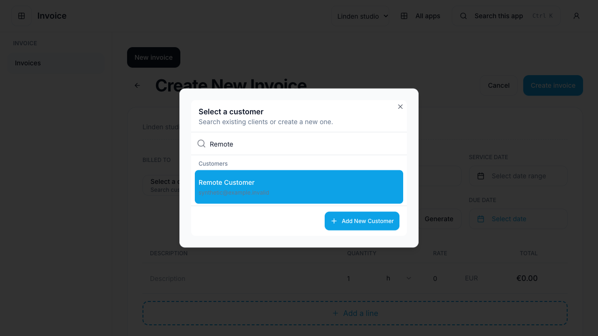
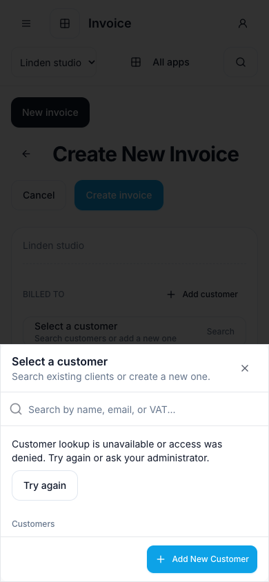
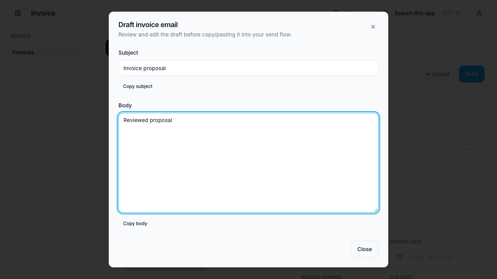
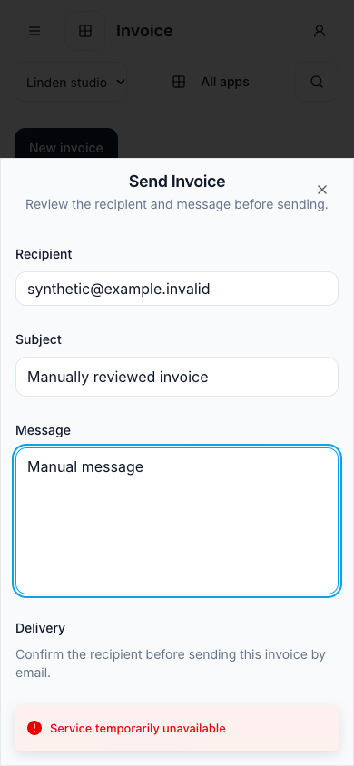

# #395 — Invoice supporting workflows and assistant boundary

## Tracking and outcome

- Issue: [#395](https://github.com/Corely-AI/corely/issues/395), parent #380.
- Prerequisites #388/#394 are closed Completed and merged into the verified base.
- Branch: `395-invoice-supporting-workflows`; base: `corely/development` at `05489029b1`.
- PR: [Draft #422](https://github.com/Corely-AI/corely/pull/422).
- Selected as the first open Ready implementation ticket without an existing PR.
- Scope: finish the supported invoice flow through existing Party/Invoice owners,
  constrain assistant retrieval/actions, and inventory unsupported settings honestly.
- Excludes new invoice/finance behavior, broad CRM/HR/settings, deployment and real delivery.

## Reuse and decisions

The [maintained composition guide](../frontend/focused-invoice-client.md#supporting-workflows-and-assistant-boundary)
contains the supporting entry-point inventory and current limits. Existing API
façades, contracts, inline customer form, Copilot panel, send dialog, PDF pipeline,
capabilities and scope providers are reused.

Customer search now uses the server search/cursor API, explicitly restricted to
customer role. Opening the picker triggers lookup; invoice browsing needs only
invoice-read and its stored billing snapshot. The full live customer enrichment
has been removed from invoice detail for every client, keeping the customer-read
boundary meaningful. Existing snapshot name/email/VAT remain available.

The focused panel only generates reviewable invoice email text. Invoice entitlement
now guards both draft endpoints. Generic AI/tools/documents are excluded from the
Invoice BFF; the record-owned PDF endpoint is retained. Invoice service outages
are opt-in request-local failures, while authentication/permission failures still
invalidate the whole verified session. No automatic retry or send is introduced.

Legacy tax/contact/payment configuration cannot simply be mounted: the shared
settings UI depends on legacy auth and the payment controller lacks the needed
operation/workspace checks. Those settings remain unavailable in the focused
client. This is documented setup debt; the existing invoice flow uses owning
server defaults. No unavailable Templates or settings menu is advertised. Related
conditional business-roadmap issues #353/#355 are not promoted.

## Verification

| Command/check                                                                                                                                                          | Result and limits                                                                                                                                                                                                                            |
| ---------------------------------------------------------------------------------------------------------------------------------------------------------------------- | -------------------------------------------------------------------------------------------------------------------------------------------------------------------------------------------------------------------------------------------- |
| `pnpm --filter @corely/invoice typecheck`                                                                                                                              | Passed.                                                                                                                                                                                                                                      |
| `pnpm --dir services/api typecheck`                                                                                                                                    | Passed.                                                                                                                                                                                                                                      |
| `pnpm --filter @corely/invoice build`                                                                                                                                  | Passed; existing bundle size warning.                                                                                                                                                                                                        |
| `pnpm --dir packages/web-features exec vitest run src/modules/invoices`                                                                                                | 4 passed on the final component run.                                                                                                                                                                                                         |
| `pnpm --dir packages/web-shared exec vitest run src/session/session-client.spec.ts src/session/feature-http-client.spec.ts`                                            | 25 passed, including 429/503 recovery and retained 401/403 invalidation.                                                                                                                                                                     |
| Targeted API Vitest (including finalize/send/reminder use cases): `invoice-support-access.spec.ts`, `invoices.controller.test.ts`, `sso-session-transport.int.test.ts` | 49 passed; 12 database-backed transport cases skipped because `SSO_TEST_DATABASE_URL` was unset. Real RBAC/entitlement guards, synthetic authentication/grants/command sinks in the new HTTP fixture.                                        |
| Full shared session directory                                                                                                                                          | 68 passed, 3 failures and 3 errors in unchanged workspace-provider tests: Node 24/DOM `AbortSignal` incompatibility. Same 3 failures/errors reproduced with the base revision's session-client source loaded by a temporary Vitest override. |
| Focused Invoice browser suite                                                                                                                                          | 11 passed; final mobile send capture/viewport assertion also passed independently. Synthetic session/API responses; no live identity, database, PDF generation or email service.                                                             |
| Changed-source ESLint                                                                                                                                                  | Zero source errors; ignored-file warnings recorded. Forced lint of the excluded test file fails because it is outside the TypeScript project-service configuration.                                                                          |
| `pnpm arch:check`                                                                                                                                                      | Existing checker fails with ENOENT for absent `services/worker/src`; no worker is created.                                                                                                                                                   |

The first browser run exposed a list-page live-customer dependency and an
assistant 503 invalidating the entire client. Both were corrected. No historical
pass is presented as a fresh full-suite result. The base snapshot, current
permission/grant fixture limits, failed broader checks and skipped DB checks keep
this work Draft. No production authorization or provider-delivery claim.

## UI/UX evidence

Actual Invoice Vite client, synthetic `user-a`, tenant/workspace A, English.
Desktop 1280×720 and phone 390×844. Screenshots are visually inspected after
animations settle; keyboard search/selection and inline creation are exercised
through the rendered flow. Existing list/detail/edit/create/finalize/PDF,
empty/loading/error/denied and draft-navigation scenarios are rerun.

| Desktop customer search                                                                   | Mobile lookup failure                                                                            |
| ----------------------------------------------------------------------------------------- | ------------------------------------------------------------------------------------------------ |
|  |  |

| Assistant review                                                                              | Manual send after AI outage                                                                |
| --------------------------------------------------------------------------------------------- | ------------------------------------------------------------------------------------------ |
|  |  |

EN/DE/VI lookup
errors use existing locale resources; this is not the complete #402 locale or
screen-reader audit. No customer/personnel/credential data is used.

## Impact and remaining work

No migrations, packages, new domain owners or deployments. Legacy clients retain
their transport defaults; shared customer search/send controls and invoice snapshot
projection intentionally change for all consumers. Reverting this branch restores
the former behavior without data rollback. The root unit command was stopped when a neighboring integration-named unit suite loaded a pre-existing local database target that had not been verified disposable. The repository-wide pre-push hook is not a passing check; publication uses the hook-supported bypass with targeted evidence and keeps Draft.

Focused settings editing, live outbound
delivery and full multi-origin acceptance are not established by these fixtures.
