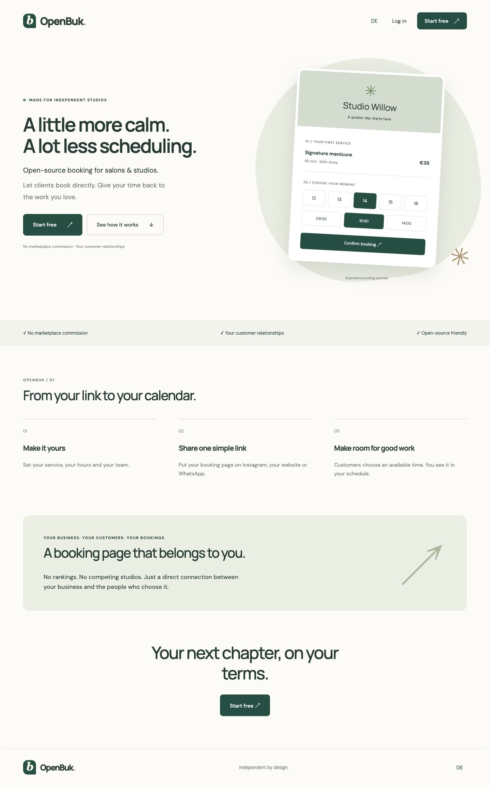
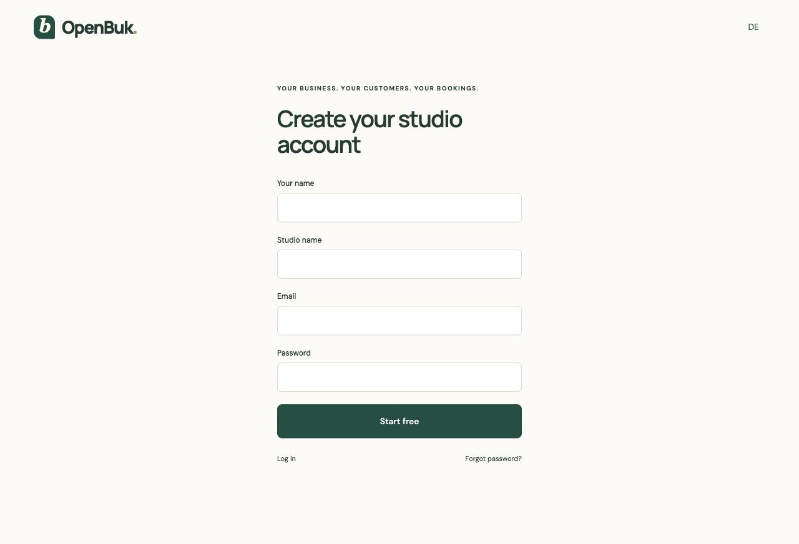
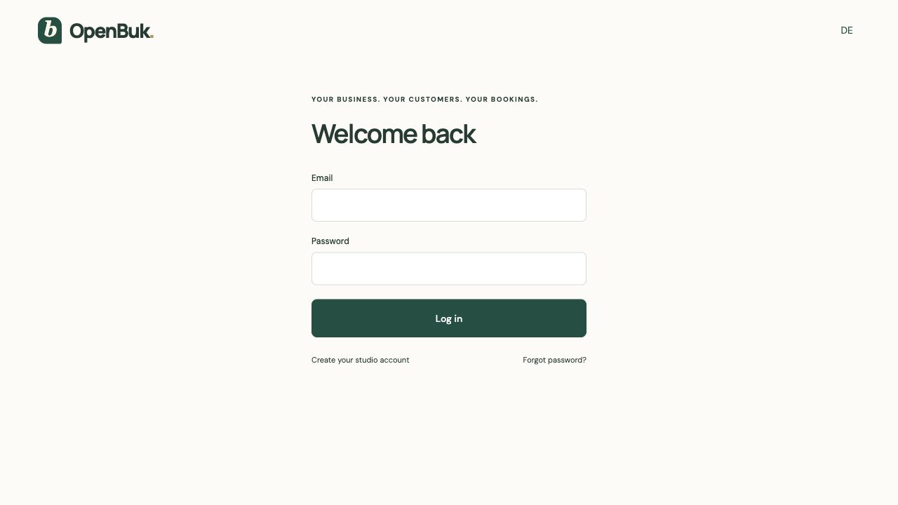
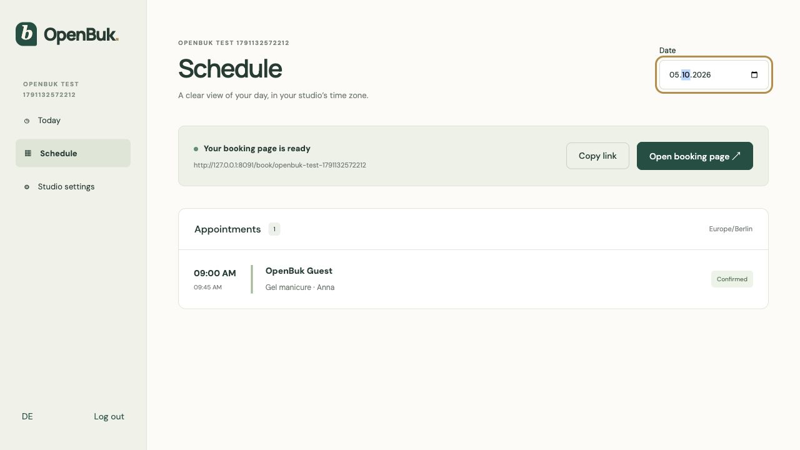
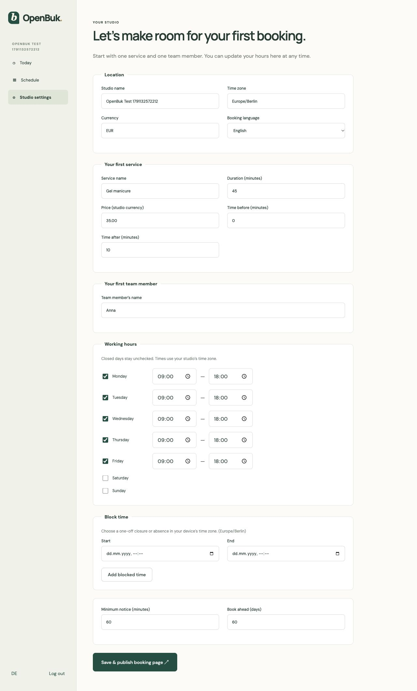
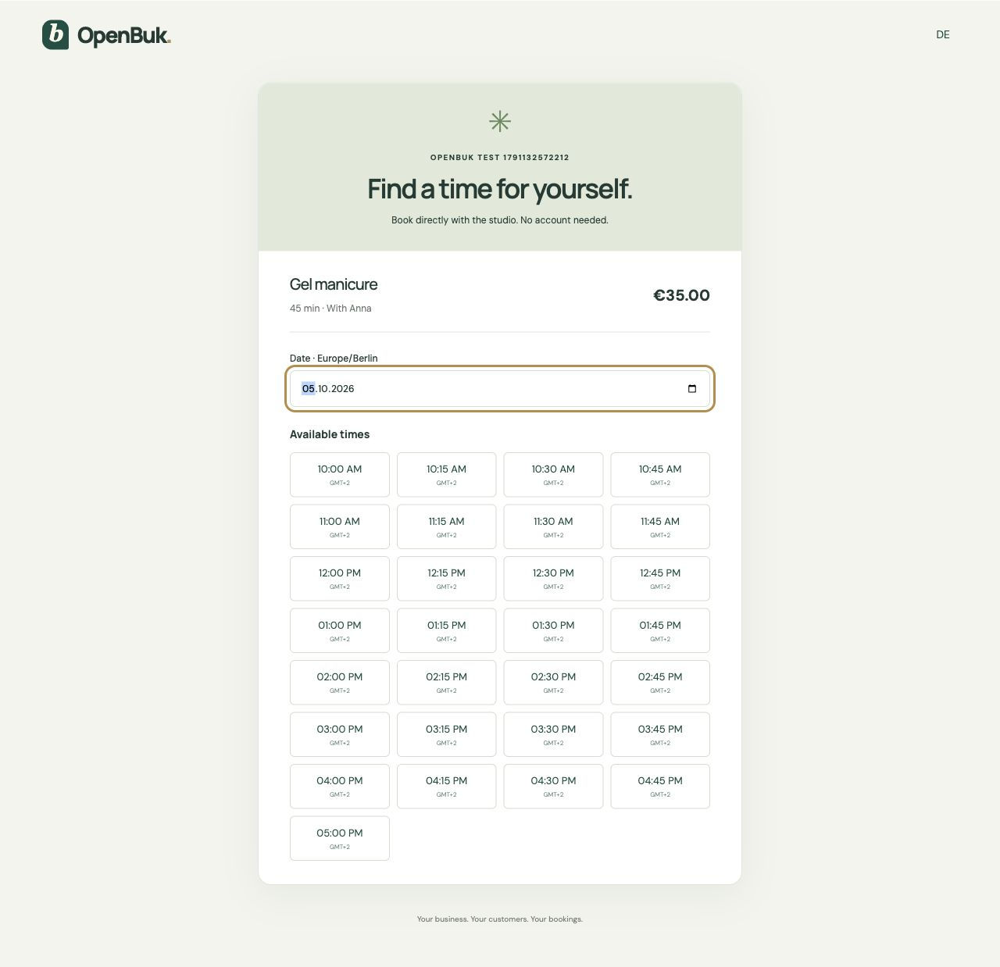
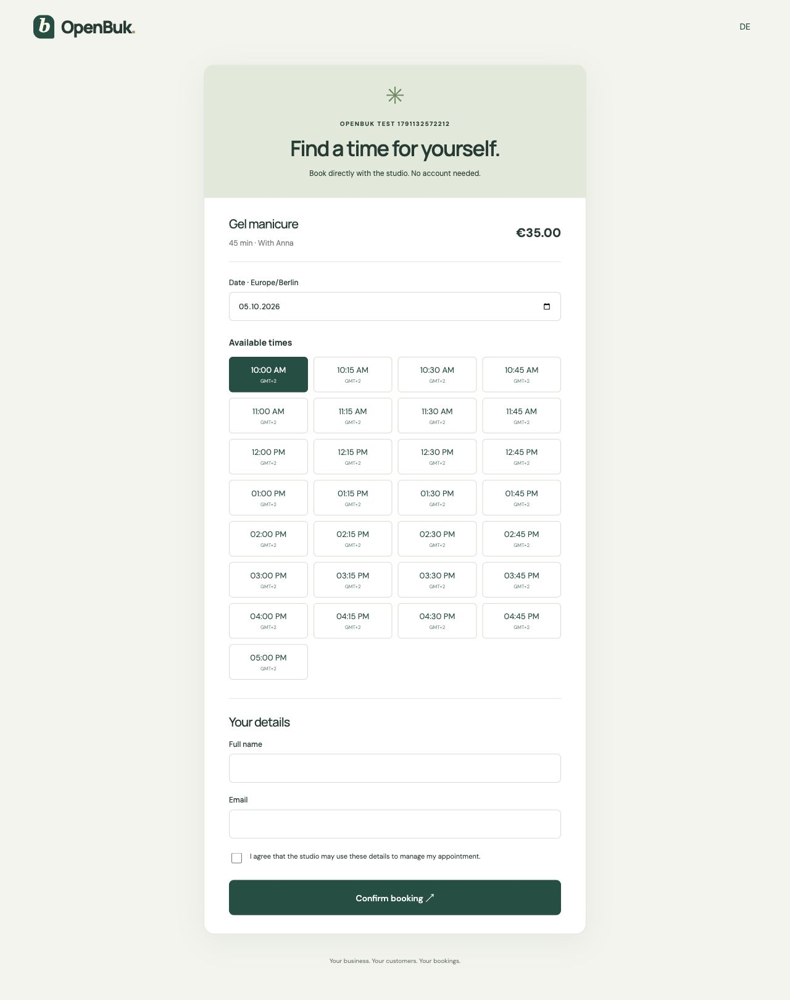
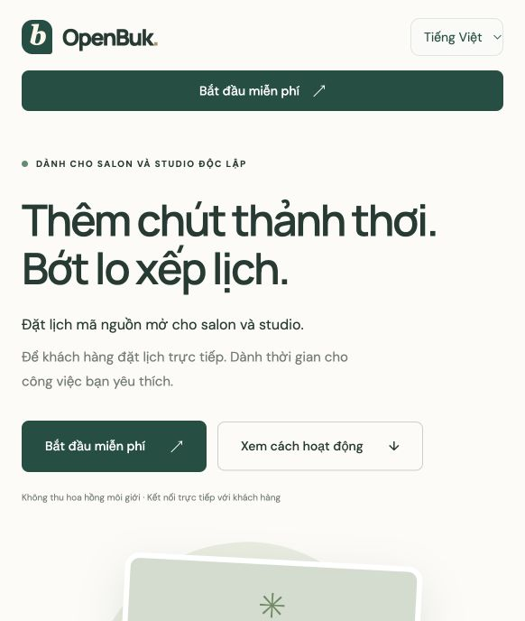

# OpenBuk — App screenshots

Captured on 4 October 2026 from the local app at http://127.0.0.1:8091. These are full-page screenshots of the implemented first vertical slice, using the isolated test studio and synthetic appointment data.

This walkthrough covers the current one-service, one-staff flow. See [implementation notes and roadmap](docs/products/openbuk/README.md) for scope and validation.

## Homepage

Route: `/`. Marketing page with the OpenBuk positioning, an illustrative booking preview, and signup entry points.

## Create an account

Route: `/signup`. Branded signup form for the studio owner.

## Log in

Route: `/login`. Existing owners sign in through the shared Corely authentication service.

## Appointment schedule

Route: `/app/calendar`. The test studio’s persisted appointment on 5 October 2026, shown in Europe/Berlin time.

## Studio settings

Route: `/app/settings`. Studio details, one service, one staff member, recurring working hours, blocked time, buffers, and booking limits.

## Public booking — availability

Route: `/book/:studioSlug`. Customers choose an available time without creating an account. The existing 09:00 appointment is excluded from availability.

## Public booking — guest details

Route: `/book/:studioSlug`. Selecting a time reveals the guest contact form and appointment-management consent. This capture stops before submission.

## Languages: English, Deutsch and Tiếng Việt

The app now has a three-language selector on marketing, authentication, administration,
and public booking screens. A visitor's choice persists across reloads. Studio settings
also allow any of the three languages as the default booking language. The earlier
screenshots above show the initial English interface; the current selector is shown below.

